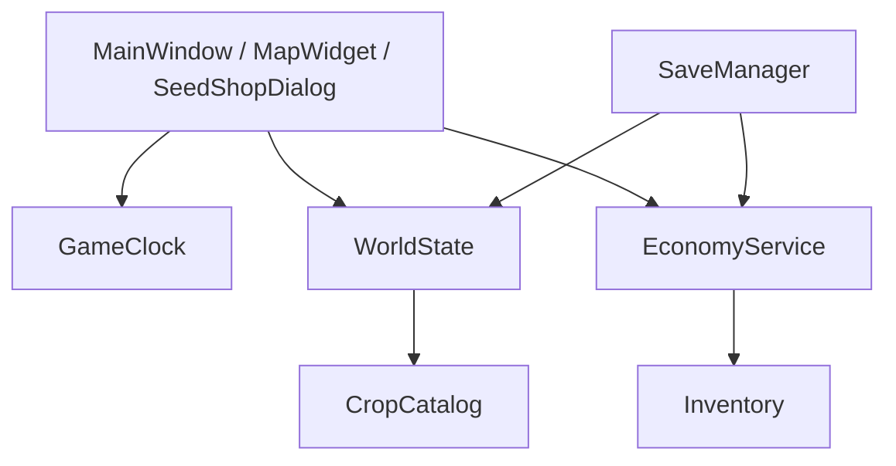

# 工程架构与当前基线

版本：v1.0（2026-10-28）。需求入口是 [DEVELOPMENT.md](DEVELOPMENT.md)，玩法规则入口是 [GAMEPLAY_DESIGN.md](GAMEPLAY_DESIGN.md)。代码和 `CHECK.pro` 是实现事实来源。

## 1. 技术栈

- C++17、Qt 6 Widgets、Qt Multimedia、QPainter、Tiled、QRC、qmake。
- `WorldState` 保存土地、树木、作物和浇水状态。
- `GameClock` 是日期、时间和睡眠跨天的唯一来源。
- `MapRenderer` 只负责根据状态绘制，不在绘制期间修改业务数据。
- `CropCatalog` 保存作物的生长天数、产量、售价和种子价格。
- `Inventory`、`EconomyService` 和 `SaveManager` 分别负责资产规则与持久化。

## 2. 当前代码状态

第一阶段代码已合入 `main`（`ff21ee8`）：

| 能力 | 状态 |
| --- | --- |
| 地图、角色、碰撞、工具栏 | 已实现 |
| 锄地、播种、浇水、作物成长和收获 | 已实现，小麦/土豆两种配置 |
| 睡眠和日结算 | 已实现 |
| 有限背包、金币、到站出售、种子商店 | 已实现 |
| JSON 存档和备份恢复 | 已实现 |
| 自动生产、运输、离线收益 | 当前版本不实现 |
| 中文引导、独立作物贴图、完整升级 | 下一阶段 |

## 3. 调用关系

UI 可以提交输入和显示查询结果，但不能维护第二份金币、种子或作物数量。任何收获、出售或购买都必须先校验，再一次性提交状态变化。

## 4. 关键规则约束

1. 日期只能由 `GameClock` 推进；睡眠和自然跨日调用同一日结算。
2. 作物成熟判定使用 `CropType` 和生长日，不把图块 GID 当成业务状态。
3. 背包不足时整格收获失败，成熟作物保留在原地。
4. 出售必须通过收购点位置校验，远处不能直接扣除背包。
5. 购买失败不扣金币、不增加种子；存档失败不覆盖上一份有效存档。
6. 绘制、动画和音频回调不能发放物品或金币。

## 5. 下一步架构工作

- 将 HUD、提示和商店状态更新集中到稳定的只读查询入口。
- 为新作物使用配置扩展，避免在窗口回调中写死成长和价格。
- 把存档版本与新增地块/作物兼容策略写入测试 fixture。
- 在 S3 决定是否需要更细的控制器拆分；当前不为暂缓的自动化系统预留空类。

## 6. 验证

应用和核心测试使用同一 Qt Desktop Kit 构建。验证命令和阶段门见 [IMPLEMENTATION_PLAN.md](IMPLEMENTATION_PLAN.md)。
