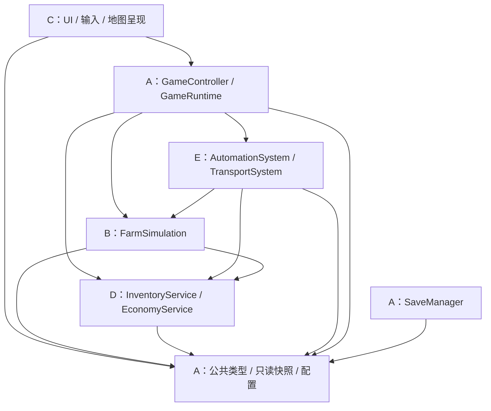

# 工程架构与现状分析

规划版本 v0.2，2026-10-22；代码基线 `8ddf7056e11b95e1ad3735daa7f08588f41f6cb0`。本轮只建设文档，文中的新类、目录、接口、测试和 CI 均是待实施方案，不代表已经存在。组织调整为五人团队，成员姓名和 GitHub 账号待填。

## 1. 阅读顺序与事实来源

先读 [DEVELOPMENT](DEVELOPMENT.md) 的需求，再读本文件、[五模块](TEAM_MODULES.md)、[目录迁移](DIRECTORY_STRUCTURE.md)、[接口](INTERFACE_CONTRACTS.md)、[文件所有权](FILE_OWNERSHIP.md)、[执行计划](IMPLEMENTATION_PLAN.md)、[Git 工作流](GIT_WORKFLOW.md)、[测试策略](TEST_STRATEGY.md)。各 Codex 开工前读根 [AGENTS.md](../AGENTS.md)。

实现事实以源码和 CHECK.pro 为准；需求优先 README / DEVELOPMENT，其次 PROJECT_PLAN / GAMEPLAY_DESIGN，素材以 ASSET_AUDIT 和实际资源为准。工程方案在本组文档维护；原 DEV 编号和玩法规则仍以 DEVELOPMENT 为入口，不重复维护第二套数值表。

## 2. 四类需求台账

| 分类 | 内容与证据 | 工程处理 |
| --- | --- | --- |
| 【已实现】 | mainwindow.cpp 中 main()；Qt Widgets / Multimedia；CHECK.pro 的 C++17、qmake、resources_big | 保留入口和工具链 |
| 【已实现】 | MapLoader 读取 TMJ/TSX，校验尺寸和图层长度，加载 QPixmap；MapRenderer 绘制静态和动态层 | 复用，不另写地图引擎 |
| 【已实现】 | WorldState 保存树木血量、耕地、种植时间和 CropType，清树时同步图块与碰撞；生长仍为统一阶段 | 保留可用规则及测试，再抽出语义状态 |
| 【已实现】 | ImageMovementWidget 的 WASD、角色动画、镜头跟随、脚部碰撞；ItemBar 六槽；HUD 小麦计数；音频播放代码 | 保留外观与操作，运行效果仍须验收 |
| 【已实现】 | GameClock 单调计时提供累计游戏分钟，窗口日历与生长引用它；5 个 Qt Test 测试函数 | 不能说“没有统一时钟”；也不能把它当完整暂停/离线系统 |
| 【已确认待实现】 | 有限背包、扩容、整格容量安全收获；亲自到固定站点出售；金币、购买五项基础强化、永久种子解锁、存档 | M1，见 DEVELOPMENT §2–3 |
| 【已确认待实现】 | 范围工具、灌溉、扩地、不同作物行为、中文 UI | M2；M1 已含三格收割和首次扩地最小版 |
| 【已确认待实现】 | 先手动后自动；采收箱、代售、固定路线运输、到站结算、能力受限的离线推进 | M3；只复用一套农田/库存/经济规则 |
| 【已确认待实现】 | 引导、经济试玩、部署；保留像素 UI 和素材风格 | M4 |
| 【可调整试验参数】 | 12→24→48→96 背包、6→12→24 土地、作物名单/时长/产量/售价、3 格距离、设施范围/周期/吞吐、2 小时离线上限、30–45 分钟体验目标 | 留在既有玩法文档；后续配置化，不当作工期或已验证平衡 |
| 【尚待决策】 | 字体最终选型、图集品种映射、设施外观、升级最终价格/前置、首版具体区域、订单/专精/加工的后续投入 | 不阻塞通用库存/作物接口；具体资源与内容落地前确认 |
| 【尚待决策】 | 五人姓名/账号、可用工时、仓库分支保护设置、CI 固定 Kit、以下工程接口冻结 | A 登记；当前以 A–E 表示岗位，不虚构账号 |

详细背包、产量快照、再生、保留品、装车唯一归属和离线规则继承 DEVELOPMENT §3、§8–9；本方案不改变它们。原文标注“建议”的解锁顺序和外观继续保持候选属性。

## 3. 实际调用链与问题

当前 `MainWindow` 拥有 GameClock、MapWidget、角色与 HUD；MapWidget **按值持有 WorldState**，每秒定时推进生长。ImageMovementWidget 拥有 PlayerController，后者持有 `QPointer<MapWidget>`，经控件执行耕种/砍树。MapRenderer 读 WorldState 图层。CollisionDetector 持有 WorldState 碰撞层的非拥有指针。不存在拟议 GameState、GameController、InventoryService 等服务。

| 问题 | 源码证据与影响 | 对应工作 |
| --- | --- | --- |
| 收获仍在 UI 内 | MapWidget::mousePressEvent 先 harvest，再发 mapClicked，角色再 useToolAt；种子选中时可能同次点击收获后立刻播种 | DEV-002 统一一次输入一个动作；自动补种必须显式购得 |
| 数量没有统一状态 | MainWindow::m_wheatCount 只增小麦；土豆已记录类型但不会显示入库 | DEV-003/004，删除计数前先改成库存只读显示 |
| 业务依赖渲染 | WorldState::harvest 用成熟 GID 243 判定；isPlantable 用耕地 GID；MapData 包含 QPixmap | B 语义地块；C 渲染映射；A 公共无图像地图定义 |
| 控件仍持有规则入口 | PlayerController 通过 MapWidget 改世界；MapWidget 的定时器驱动生产 | C 变输入适配，A 调度，B 推进 |
| 时间职责尚不完整 | GameClock 无 pause/resume/restore；角色位置和动画同一个 100ms 定时器 | 不改日历速度，拆生产时间与绘制，并让角色位置进入统一状态 |
| 边界不能视为已完工 | CollisionDetector 用 QRect::right()-1/bottom()-1；负地图坐标整数除法趋零；角色未显式限制地图世界范围 | DEV-002 补精确边界测试后修复，不能沿用现有测试少量断言作充分证明 |
| 加载与生命周期 | MapLoader 的 TSX 属性读取失败未传播；忽略 objectgroup；MapWidget 加载失败后窗口仍继续组装；碰撞层借用指针 | 语义导入、失败中止或错误页；替换状态后重新绑定只读快照 |
| 布局和素材 | 固定 520×320、多处坐标；ToolProperty 混有路径和伤害，ToolAnimation 含 QPixmap；字体缺汉字 | C 保留风格、拆表现数据，不让业务头文件包含 QPixmap |

`character.h` 是未加入工程的占位声明；`mainwindow.ui` 未列入 FORMS。二者先保留登记，不能仅凭暂未使用删除。地图、音频、精灵、图集和许可证均保留。

## 4. 版本差异与裁决记录

| 编号 | 冲突/历史表述 | 本轮处理及理由 |
| --- | --- | --- |
| R-01 | 旧规划称“MapWidget 内全部规则、固定小麦信号、时间分离、树木未闭环” | 已落后于 8ddf705：规则部分已到 WorldState，CropType 已区分，GameClock 共用，树木同步已有测试。更新事实段，保留未完成边界任务 |
| R-02 | README 写组合键斜向移动 | keyPressEvent 会清其他方向标志；更新为 WASD，组合键作为待测项，不能保证斜走 |
| R-03 | README 记录重构后 Qt 6.8.2 编译/测试，旧文档记录 6.10.3 编译 | 是不同版本的历史记录。本轮未执行构建/运行，DEV-001 必须重新记录目标提交和 Kit |
| R-04 | 旧图把补种归 FarmSimulation、库存转移归 EconomyService | 按本次五模块职责收敛：E 决定补种时机，B 执行合法 plant；D InventoryService 管转移，EconomyService 管成交；并无新玩法 |
| R-05 | PROJECT_PLAN 的 M0 写“正确入库”，DEVELOPMENT 的 DEV-004 才是有限背包；M1/M2 都有范围与扩地 | M0 保留原型收获反馈和独立作物状态；真实有限入库在 M1。M1 三格/首次扩地，M2 排播/更大范围/后续扩地。不提前交付整套 M2 |
| R-06 | “个人项目”、人数未定 | 本轮明确五人协作，只更新组织，不推断商业用途变化；素材使用事实记录保留 |
| R-07 | 技术接口、取整、事件同刻顺序尚无最终代码 | 下述为推荐工程契约，阶段 1 由涉及成员确认冻结；价格取整等可影响玩法的选择标待确认，不能擅自变成已确认数值 |

## 5. 五模块依赖与状态方案

一级责任域恰好 A 核心/存档、B 农田、C 呈现/角色/UI、D 经济/成长、E 自动化/物流。目录数量不等于责任域数量。A 负责集成，不拥有其他模块规则的重写权。

图中区分 A 的组合根与 A 的底层类型：服务只能依赖 `core` 类型，不能反向包含 `gamecontroller.h`；A 的控制器可包含服务实现。C 的纯移动规则由 A 调用并写回玩家状态，该纯文件仅依赖公共数据，不依赖 QWidget 或控制器，避免 UI 与控制器头文件循环。

采用一个 GameState 的普通值对象，按农田、玩家、库存/经济、设施/运输子域组织。UI 只能拿快照；GameController 独占活动状态及提交权。服务按受限写句柄修改临时候选状态，各自只能写自己的子域；存档恢复仅能在验证完整候选后由控制器替换活动状态。禁止可写全局变量、公共 mutable map、每个模块各存一份资产。

小地图首版用候选状态复制 + 成功交换提交来保证原子性，失败丢弃候选。Qt 容器的值语义可降低初始复制成本；不引入数据库、ECS、事件溯源、插件总线、多线程业务或通用事务框架。范围收割按单格提交，出售全部按整批提交。将来有性能证据再局部优化，规则不变。

## 6. 渐进式改造关口

1. 冻结接口，记录原型基线；本轮不编译不移动文件。
2. C 统一地图输入，保留类名、main() 和资源 URL；B 在 WorldState 原位置工作。
3. A 接 GameState/控制器，B 移交世界状态所有权；C 将 MapWidget 改为只读视图并移除生产 timer。旧转发方法短期委托新入口，不能同时写新旧状态。
4. 按 [迁移表](DIRECTORY_STRUCTURE.md) 分 PR 搬源文件；A 同步 qmake。每步编译、Qt Test 与原型 GUI 冒烟通过，才开启下一窗口。
5. B/D 贯通收获库存，D/C 完成到站交易，A 存档。E 早期做契约场景和模拟测试设计，M3 才实现自动化业务。

保持 C++17、Qt 6 Widgets、Qt Multimedia、QPainter、Tiled、QRC、Qt Test 和 qmake；本阶段没有技术栈迁移建议。需要新增配置不等于现在创建 data JSON 或改变数值。

## 7. 规划自检与开工清单

| 检查 | 结果/证据 |
| --- | --- |
| 继承玩法 | 原型/目标/试验/待决四类分离；不引入新循环 |
| 恰好五域 | TEAM_MODULES 只有 A–E |
| 核心文件负责人 | DIRECTORY_STRUCTURE + FILE_OWNERSHIP；迁移前后均单主责 |
| 无资产双写 | INTERFACE_CONTRACTS 的候选事务和子域写权限 |
| 并行有先决条件 | IMPLEMENTATION_PLAN 的契约冻结门，草案可设计但不得各自实现不同签名 |
| 交付可验 | 每个 DEV 卡片有测试、人工验收和通用 DoD |
| 迁移成本 | M0 窗口 W1–W3；保留兼容入口与资源 URL |
| 构建可持续 | 仅 Markdown 变更；未来每步 qmake 双目标检查，本轮未声称执行 |
| 原任务不失效 | 16 个父编号及依赖保留，拆分只用后缀 |
| 文档冲突 | R-01–07 显式记录，工程细节单一维护入口 |

开始五人并行开发前：

- [ ] 将 A–E 映射到实际成员与 GitHub 账号，确定 A 为集成协调人。
- [ ] DEV-001：干净构建应用与现有测试，实际 GUI 检查，记录提交、Kit、失败和日志。
- [ ] 阶段 1：共同审阅并冻结 IC-01–IC-08 的 M0/M1 部分；M3 部分仅冻结数据扩展边界。
- [ ] 明确试验参数来源，字体/图集映射与取整等待决项登记，不阻塞无关任务。
- [ ] A 建立兼容头文件/契约测试最小 PR 后，其他成员拉同一 main 提交开始实现。
- [ ] 认领任务、分支、文件锁和迁移窗口；确认根旧文件此刻归谁。
- [ ] A 配置 PR 模板、最小 CI 与可用的 main 保护；实际设置前不能视为已启用。
- [ ] 分别打开五个独立工作目录，每个 Codex 读取 AGENTS 与本模块入口。

以上未勾选项是未来实施门槛，不表示需要等待用户逐条批准本轮文档工作。
