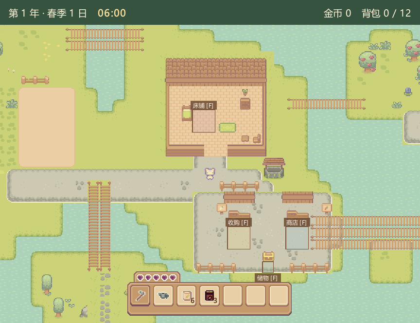

# 底部居中物品栏（2026-11-14）

交付更新：本文件记录的底部布局、深色底框替换及图标居中调整，随背包格位/拖动功能一并按用户要求提交推送到 `lxk`。下文“尚未提交”为当时迭代状态，当前功能和验收以[背包拖动](INVENTORY_DRAG.md)为准。

图标居中修正：不再使用旧的32像素点击格或固定偏移量绘制图标，改为将原物品栏352×96图片中的真实槽位边界映射到当前控件。场景物品栏和背包首排按同一几何中心绘制；图标可见像素的透明包边不参与中心定位，保持原图缩放比例，数量对齐内框右下角。下方储物图标也使用同一居中辅助函数。鼠标命中与库存规则未改变。主程序构建成功，面板8、窗口5、首排联动6项共19项通过；截图已目视检查，未做原生桌面人工试玩。尚未提交推送。

选中底框修正：此前缩小的深色框叠在浅框上会露出浅色边缘，已改为预先生成七种完整物品栏底图。选中槽位按原图实际边界（x=10+48×格号，y=30，42×43）先清除为木色底，再以现有深色大槽位（99,98,42,44）整格替换，最后绘制图标和数量，未选槽位及整体外框原样保留。场景和背包首排共享完整底图，下方格子直接使用深色框。实际场景及背包截图已目视确认不再露出旧浅框；构建成功，针对性面板/窗口/联动19项通过。本轮未提交推送。

后续选中态调整：按用户要求移除额外黄框/红框描边，统一改用既有 `:/farm-ui/slots.png` 的深色槽位（源矩形104,56,32,34）作为选中底图，先画底图再画物品与数量。场景物品栏、背包首排及下方选中格复用 FarmIcons 的同一绘制函数；无资源、库存或选用规则变化。主程序构建成功，面板8项、窗口布局5项、首排联动6项共19项通过。此为针对装饰及受影响交互的验证，未重新运行全部套件，未做原生桌面人工试玩。尚未提交推送。

用户要求移除底部大块黄色底栏和解释性文字，仅把物品栏放在下方中间。本轮在 `0cb9742` 上支援 C/E 的布局与物品栏呈现，修改 `mainwindow.cpp`、`itembar.cpp`、相关窗口测试和本文，不改资产、输入契约、地图数据、存档或素材。本轮没有提交推送。

地图视区从320扩到408逻辑像素，覆盖原底栏占位，整个画布尺寸保持不变。物品栏作为地图上方的独立控件，水平居中，距底部8逻辑像素，继续使用已登记的七格 Premium UI 原图。画布回退背景改为深绿，不再产生黄色底栏。

移除常驻工具名铭牌，不显示底部种子/肥料汇总及状态说明。顶部日期、时间、金币和背包容量保持；重大保存错误对话框和面板内业务反馈不改。隐藏的状态快照仍供内部检查，不作为画面说明绘制。物品栏仍显示真实库存数量，点击、滚轮、0键及背包选用继续同步到角色。

## 星露谷参考

实际查阅本机第三方反编译提交 `5225ef409e42a6159a82cf81200bf6eb315c9961` 的 `StardewValley.Menus/Toolbar.cs`：构造/尺寸更新时以 `uiViewport.Width / 2` 放置格子，`draw()` 根据视口高度和边距定位，在工具栏局部绘制纹理框而非占用整条底栏。本项目沿用局部物品栏在地图上居中的方式，按用户明确要求固定在底部，不新增原作的自动上移、透明度或菜单系统，也不复制原作资源。

## 验证

Windows Qt 6.8.2 / MinGW 13.1 Release 主程序构建成功。farm_controls 180、gameplay_panel 29、clock_ui 37项通过，共246通过，0失败，1项因音频设备条件跳过。窗口测试检查物品栏位于地图内、水平居中、距底部8像素、顶部HUD不重叠、底部说明不可见；原有核心操作与睡眠回归保留。通过实际控件截图核对视觉，本轮未做原生桌面人工试玩。

1.5倍 DPI 窗口布局专项另测5项通过（含初始化与清理）。实际截图：

