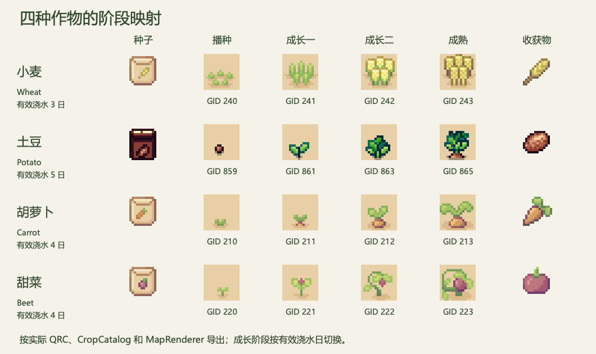

# B 作物、四季与施肥交接

**此页保留 11 月 8 日交接时的映射、原价和存档格式。** 四种作物的生长阶段和适季沿用下表。11 月 11 日集成版已经接入四种工具栏种子、商店、肥料和 v3 存档，现行价格与试玩结果见[执行计划](IMPLEMENTATION_PLAN.md#休闲种植收益)。

2026-11-08，MAP-002，负责人 GitHub：`semiconductor007`，分支：`feature/b/crops-and-seasons`。接口 v1.2 的规则与资源实现已完成，C/D/E 消费端和价格联调待确认；本记录不代表已合入 main。对应地图基线为 A 的 `ee0be11`。

## 作物目录

新增品种选定胡萝卜、甜菜；保留小麦、土豆原有生长天数、产量和价格。下列新参数为首轮配置，尚未经过全组试玩；新增作物价格需 D 复核。中文读取 `localizedName`，现有英文界面仍可读 `displayName`。全部参数以 `cropdefinition.cpp` 为唯一配置来源。

| CropType / 存档 ID | 名称 | 有效浇水日 | 每格产量 | 每颗种子价 | 每个农产品售价 | 可播种季节 | 从播种到成熟的 GID |
| --- | --- | --- | --- | --- | --- | --- | --- |
| 1 / wheat | 小麦 | 3 | 1 | 2 | 4 | 春夏秋冬 | 240、241、242、243 |
| 2 / potato | 土豆 | 5 | 3 | 5 | 3 | 春夏 | 859、861、863、865 |
| 3 / carrot | 胡萝卜 | 4 | 2 | 3 | 3 | 春秋 | 210、211、212、213 |
| 4 / beet | 甜菜 | 4 | 2 | 4 | 4 | 秋冬 | 220、221、222、223 |

每格由 `CropType` 和有效生长日决定成熟，不再通过显示 GID 判定。`stageGid(type, growthDays)` 将有效生长日映射到四阶段；未成熟时可能连续两天使用同一图片，只有到达生长天数才使用成熟图。收获后清除该株及施肥状态；漏浇只停滞，不死亡。小麦四季可播种，冬季也有基础种植循环。

此图由项目实际 QRC、MapData 和 MapRenderer 导出，未使用概念图替代实际素材。运行窗口中的新工具、商店和 HUD 尚未全部接入。

## 素材和图标

小麦/胡萝卜/甜菜使用原 `sprout/Farming Plants.png`；土豆使用仓库原有的 `Farm RPG FREE 16x16 - Tiny Asset Pack/Objects/Spring Crops.png`，不是把其他品种当作土豆。新增 `tsx/Spring_Crops.tsx`（14 列、112 格），`map6.tmj` 仅追加 `firstgid=789`，原地图各层、GID 和坐标未变。地图现为 19 套图集，QRC 共 76 项。

图标通过 `CropDefinition::seedIcon` / `harvestIcon` 返回资源路径和像素矩形；所有图标都是 16×16，按整数倍最近邻显示。

| 品种 | QRC 图片 | 种子矩形 x,y,w,h | 收获物矩形 x,y,w,h |
| --- | --- | --- | --- |
| 小麦 | `:/tilesets/sprout/Crop_Items.png` | 0,128,16,16 | 16,128,16,16 |
| 土豆 | `:/tilesets/sprout/Spring_Crops.png` | 112,80,16,16 | 128,80,16,16 |
| 胡萝卜 | `:/tilesets/sprout/Crop_Items.png` | 0,32,16,16 | 16,32,16,16 |
| 甜菜 | `:/tilesets/sprout/Crop_Items.png` | 0,64,16,16 | 16,64,16,16 |

`Crop_Items.png` 是仓库原有 Sprout Lands Premium 的 `Objects/Items/farming-Plants-items.png` 的 QRC 别名；土豆图片同样只增加别名，不复制文件、不上传新购 UI 包。保留原素材及许可说明。Farm RPG 目录内尚未找到完整许可文本，发布前由 A 补核原始来源和发布授权，不将“仓库已有”视为新的许可证明。

## 四季日期接口

`SeasonCalendar` 是纯换算，不维护时钟。E 继续拥有唯一 `GameClock`；以 `dateForDay(clock.day())` 或 `dateForMinutes(clock.elapsedGameMinutes())` 查询。`SeasonDate` 返回 `year`、`season` 和 `dayOfSeason`；年份和季内日期从 1 开始，累计游戏日从 0 开始。

- `DaysPerSeason=7` 为首轮试玩值，集中在 `seasoncalendar.h`，并非最终平衡结论；一年 28 天。调整季长会重新解释已有日期，测试档需随配置重新建立。
- 日 0/6 为第一年春季第 1/7 天；7、14、21 分别进入夏、秋、冬；日 28 进入第二年春季。
- `seasonId()` 返回 spring/summer/autumn/winter，`seasonName()` 返回中文。负数查询夹到开局；实际播种传负日期会失败。
- `CropCatalog::canPlant()` / `canPlantOnDay()` 供界面预检，`WorldState::plantSeed()` 再做规则校验。非适季失败，种子事务回调返回 false，不扣种。
- 季节只限制新播种。已种作物换季后继续成长，成熟作物继续保留；恢复存档不因当前季节丢弃作物。
- E 跨日必须依次调用 `advanceDay(completedDay)` 结算每个已结束日期；相同或更早日期重复调用无效。此入口只结算传入的一天，不会替 E 补齐跳过日期。
- 午夜自然跨日、晚间/凌晨睡眠和季节 HUD/环境仍属 E 待实现；本次没有修改 GameClock，不代表连续昼夜已经可玩。

## 一种基础肥料

固定效果：每株未成熟作物最多施用一次。`WorldState::fertilize(tile)` 成功时标记已施肥及待生效，不立即长大；在下一次有浇水的日结算中，正常增长 1 天并额外增长 1 天，上限为该品种成熟天数。未浇水时保留待生效奖励；奖励使用后不能对同株再次施肥。收获后新播种的作物可重新施肥。

返回 `FertilizeResult { success, failure }`；失败原因有 InvalidTile、NoCrop、AlreadyApplied、AlreadyMature，失败不改变地块。`isFertilized()` / `hasPendingFertilizerBonus()` 可供 C/E 显示；`DayAdvanceResult::fertilizerBonusesUsed` 统计本次实际消耗的奖励。

D 仍需实现肥料购买、价格、库存及存档；C 接工具选择和地图施用，E 接反馈。调用顺序应为：D 检查库存 → 在同一同步操作中调用 B 的 fertilize → 仅 success 时扣 1。不可先扣再尝试，也不能让绘制触发施肥。当前接口不拥有库存，本次未实现或声称肥料库存事务已经通过联调。肥料物品图标与价格由 D/A 接入时登记，不复用作物种子 ID 充当肥料。

## 新存档字段

`SavedCropState` 增加 `fertilizerApplied`、`fertilizerBonusPending`，默认 false。二者为真实作物状态，保存并恢复；不保存第二份当前季节。待生效必须已施肥且未成熟；非法快照恢复失败，原状态不变，重复读档/同日结算不会再次发奖。

`SaveManager::SchemaVersion=2`，JSON 中两个字段必须为布尔值。按本轮“新局验收，不迁移旧档”要求拒绝版本 1；不改写旧文件。已有主窗口在主档和备份均无法加载时关闭自动保存，显示保留原档提示。要体验新局，先自行备份并移走旧主档及 `.bak`；不得通过删档解决加载失败。本次验证使用临时目录/独立测试应用数据，没有修改个人默认存档。

## 交给其他成员

| 消费者 | 可直接使用 | 尚需完成 |
| --- | --- | --- |
| A | 已追加 TSX/QRC、相对路径、实际阶段图；后续四季资源见 SEASON_ASSETS | 原图与新增配色资源已登记；Farm RPG FREE 发布许可仍待确认 |
| C | cropTypes、stageGid、图标、WorldState 规则 | 工具栏全部四种种子、肥料选择/施用、背包同步及反馈 |
| D | 稳定 crop ID、价格初值、全部品种可用的现有经济服务、v2 作物字段 | 四种种子的商店/背包显示、肥料资产事务和保存，确认价格 |
| E | SeasonCalendar、localizedName、施肥/日结算统计 | 连续时间、统一跨日调度、两类睡眠、四季/HUD/昼夜显示与音效 |

当前主游戏工具栏和种子商店仍只显示小麦、土豆；胡萝卜、甜菜的规则/资源/经济服务可用，不等于已能从普通 UI 购买播种。现有 MapRenderer 按世界 cropLayer 的 GID 绘制，无需复制成长规则。

本次必要跨模块补丁：A 的 CHECK.pro/tests.pro 登记季节文件、map6/TSX/QRC 登记既有图片；D 的 SaveManager 仅扩充作物施肥字段；C 的 MapWidget 增加适季预检及 plantingOutOfSeason 信号；主窗口只连接 OUT OF SEASON 提示，避免误报缺种。没有实现其他角色的整套功能；消费者审查仍待进行，不能把本记录当作队友已批准接口。

## 验证与限制

2026-11-08，Apple 芯片 Mac，Qt 6.10.3、Apple Clang 21、qmake Release：主应用编译成功；核心测试 21 项通过、0 失败（19 项测试及初始化/清理）。新增覆盖四季边界/跨年、四品种完整经济循环、非适季不扣种及跨季存量、施肥干旱等待/单次加速/重复结算/收获重置、v2 保存恢复及非法状态原子拒绝。

另用真实 QRC、MapData、MapRenderer 验证 19 套图集、16 个阶段和 8 个图标路径及边界，并导出上图进行目视检查。独立 GUI 测试程序已构建，但 Mac 锁屏阻止启动后的实际交互验证，新增界面的鼠标操作/提示未实测；音效未听测。A 地图的既有试玩记录见 MAP_EXPANSION_PLAN，不用作 B 新界面的验证。

Windows 尚未实测。本次保留 Qt 6/C++17/qmake；新增规则为 Qt Core/C++ 代码，资源使用相对路径及 QRC，原 CropType 数值、小麦/土豆价格和原有地图 GID 保持。存档 v2 在两个平台都要求新局，旧程序不应读取新档。队友应在独立构建目录使用原 Qt Kit 编译 CHECK.pro 和 tests/tests.pro，运行 core_tests（预期 21 项通过），再检查原两作物循环、土豆新阶段贴图、非适季提示及新档重开；四种作物/肥料的完整 GUI 流程待 C/D/E 接入后共同验收。
