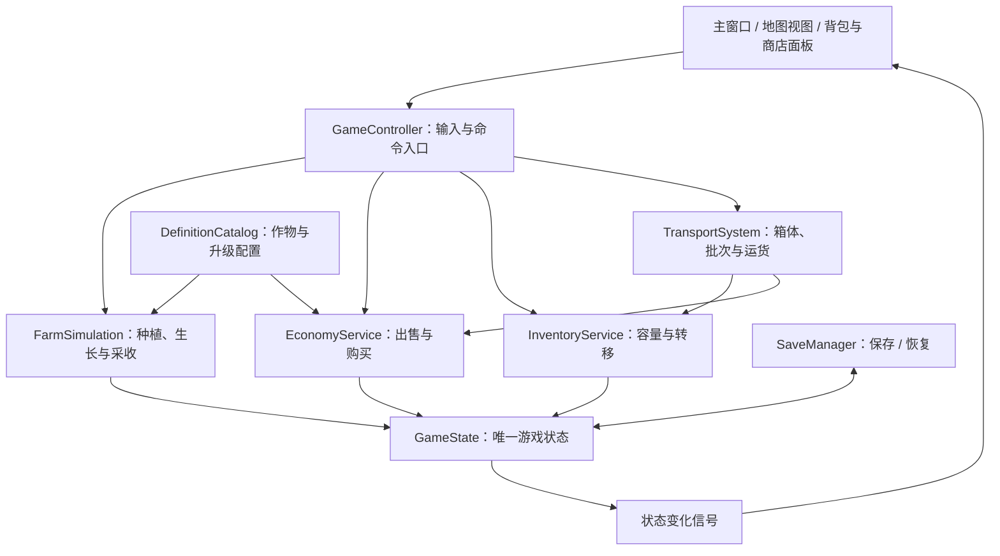

# Clover-Cog 开发文档

版本：v0.1 · 更新日期：2026-10-22 · 状态：开发基线草案。

本文件将已确认需求整理为实现顺序、数据职责、交互约束和验收标准。除特别标明的现有能力外，以下模块、接口、目录和配置均为拟议设计，尚未实现。

## 1. 文档导航与项目状态

| 文档 | 用途 |
| --- | --- |
| [README](../README.md) | 项目介绍、已实现能力、启动方法与开发入口 |
| [项目规划](PROJECT_PLAN.md) | 产品方向、强化路线和里程碑 |
| [玩法设计](GAMEPLAY_DESIGN.md) | 作物、背包、出售、设施、订单等详细规则与试验数值 |
| [素材盘点](ASSET_AUDIT.md) | 已有图集、接入状态、字体候选及补绘清单 |
| 本文 | 模块设计、开发任务与验收方法 |

当前代码是 C++17 / Qt Widgets 农场模板，具备地图、角色移动、动画、碰撞、基础耕种和小麦收获计数。有限背包、金币、亲自到站出售、强化、自动化和存档尚未实现。已在 Qt 6.10.3 / MinGW 64-bit 下完成过 Release 编译，完整游戏运行与交互验证仍待执行。

文档中的确定需求与试验参数分开管理。玩法改动应同步更新对应文档；后续实际配置文件是已实现版本数值的来源，不应让 README 的示例成为另一套配置。

## 2. 已确认需求与首版边界

### 2.1 必须保留的方向

1. 个人项目，沿用现有像素地图、角色和木色/米色 UI 风格。
2. 前期玩家亲自种菜、收菜，并操控角色携带作物到固定售卖点出售。
3. 背包有容量，能够购买扩容；满包时未收走的作物保留在田里。
4. 出售获得金币，再购买种子、工具、农田、背包及后续生产与物流强化。
5. 从手动操作逐步过渡到自动补种、采收、运输和出售。
6. 使用支持中文的字体；具体字体通过实际界面比较后确定。

### 2.2 范围划分

| 阶段 | 纳入内容 | 交付目标 |
| --- | --- | --- |
| M0 基础整理 | 坐标、边界、统一状态、独立作物 | 为背包和经济系统提供可维护基础 |
| M1 最小可玩版本 | 2 种作物、有限背包、固定收购站、金币、5 项基础强化、存档 | 种 → 收 → 装包 → 走到收购站 → 卖 → 买 |
| M2 手动成长 | 排播、范围收割、灌溉、扩地、作物行为差异、中文 UI | 操作效率和携带能力的取舍成立 |
| M3 自动化 | 补种、采收箱、代售箱、固定路线运输、自动结算、离线 | 自动区域可持续种收运售，满箱后等待而不丢货 |
| M4 首版打磨 | 引导、经济调参、错误提示、保存恢复和部署包 | 新玩家能够独立理解并完成自动农场目标 |
| 后续扩展 | 订单、作物专精、加工、新区域 | 为自动化后的收入提供新的经营目标 |

首版阶段目标是体验完整的手动到自动成长过程。玩法草案的 30–45 分钟目标不是开发工期，也不是强制解锁时间。暂不安排多人联机、复杂寻路、体力惩罚、随机灾害或周目重置。

## 3. 玩法规则的实现约定

### 3.1 作物与收获

- 以作物 ID 和生长进度作为真实状态；图块 GID 只承担绘制映射，不能作为唯一成熟判据。
- 首轮作物配置可先采用快熟型和多产型。具体名称和各阶段帧坐标需根据现有图集核对；模板小麦只可作为临时美术占位。
- 已解锁种子可重复播种，不按次消耗金币；购买新品种属于永久解锁，避免金币归零后无法恢复生产。
- 不同作物分别配置生长时间、产量、售价、阶段图及再生次数。
- 本轮收获产量在播种时确定并保存；后续购买高产升级影响下一轮播种。生长速度效果即时作用于已有进度，不能重置已完成进度。
- 收获成功后才清除或推进作物状态；自动补种必须在这一步成功后执行。
- 番茄等再生作物先减少剩余收获次数并进入再生周期，次数用尽后才执行重新播种。

### 3.2 背包与手动出售

- 初始背包容量暂试 12，后续为 24、48、96；每个农产品暂占 1 容量。上述档位为调参起点。
- 同类作物堆叠显示，背包占用量是所有农产品数量之和。金币、工具和永久种子解锁不占农产品空间。
- 某格完整产量放不下时，保持该格成熟状态，不生成掉落物，不进行补种。
- 范围工具先生成有序目标集合，再逐格采收；容量按实际成功的每格及时更新。
- 收购站有稳定 ID、地图位置和可达交互格。靠近后按 E 打开交易；提交出售时再次验证角色位置。
- 出售单个、该类全部或全部可卖农产品，只操作当前背包。面板价格来自配置与强化效果，成交总价以执行时重算结果为准。
- 背包满时允许移动、浇水、播种和提前去卖菜；仅阻止无法容纳的收获。
- 背包容量必须覆盖当前可种作物的单格最大产量；配置校验或升级前置条件需防止产生无法收走的作物。

### 3.3 升级与农田

首批 5 项强化是：高产种子、土壤改良、三格收割、背包扩容、第一次扩地。后续用独立条目扩展排播、范围水壶、补种、喷灌、代售与运输。

购买流程统一校验前置条件、当前等级、最大等级、金币和效果参数，再一次性扣款与更新状态。购买失败不改变状态。升级卡展示当前/升级后效果；价格与效果不写死在按钮回调中。

初始 6 格与后续 12、24 格菜地是试验规模。每次扩建解锁明确地块集合，不能通过重复点击再次获得同一片土地。自动化路线可以跳过最高级手动收割工具。

## 4. 模块架构与改造边界

保留 Qt Widgets、qmake、Tiled 和 QRC。优先从现有类中提取规则，再接新界面；每个里程碑结束时保持可编译。



| 模块 | 职责 | 从现有代码迁移的内容 |
| --- | --- | --- |
| GameState | 金币、玩家、所有库存、地块、等级、解锁、设施与运输状态 | MainWindow 的小麦计数，以及 MapWidget 的作物业务状态 |
| GameController | 统一命令入口、输入上下文、范围目标与交互权限 | 重复 mapClicked 回调与工具分派 |
| FarmSimulation | 生长、耕作、播种、收获、再生与补种 | MapWidget 的 plantSeed、生长和采收逻辑 |
| InventoryService | 容量、数量、保留品及库存间移动 | 新增；手动与自动采收共用 |
| EconomyService | 出售和购买结算、金币与价格校验 | 替代简单的收获计数方式 |
| DefinitionCatalog | 读取和验证作物、升级、设施配置 | tooltype 中业务参数及 GID 规则逐步配置化 |
| TransportSystem | 代售批次、小车装载、往返、到达结算 | M3 新增，与显示动画分离 |
| SaveManager | 版本化存档、原子写入、备份、恢复与离线推进入口 | 新增 |
| MapWidget / 角色 / 各面板 | 绘制、输入、动画与状态反馈 | 保留现有渲染和角色动作，界面不持有另一份金币或库存 |

首版在 GUI 线程串行处理命令，禁止槽函数之间重入结算。只有成功完成的命令才发布状态变化；显示动画不能自行发放物品或金币。

### 4.1 目录演进建议

以下是逐步新增的目标结构，不要求一次性移动原有源码。

```text
src/
  core/          # GameState、定义与纯规则
  gameplay/      # Controller、生长、交互、工具
  economy/       # 库存、出售、升级
  logistics/     # 设施、代售、运输（M3）
  persistence/   # 存档与迁移
  ui/            # 商店、背包、交易及 HUD
data/            # crops.json、upgrades.json、facilities.json
tests/           # 业务规则及集成验证（开发对应功能时新增）
docs/            # 开发、玩法、规划和素材文档
```

新增编译源需更新 CHECK.pro；新增配置、图集与字体需更新 character.qrc。地图绘制迁移期间保留旧入口，待等价验证通过后再清理重复代码。

## 5. 核心数据设计

| 数据 | 最小字段 |
| --- | --- |
| PlayerState | 角色世界坐标、朝向、当前工具、当前作物、背包 ID |
| InventoryState | 唯一 ID、类型、容量、按物品 ID 保存的数量、各物品保留数 |
| CropDefinition | 唯一 ID、名称键、生长时长、基础产量、售价、每件占用、阶段帧、再生参数 |
| CropState | 地块位置、作物 ID、生长进度、本轮确定产量、剩余可收次数、照料状态 |
| PlotState | 地块 ID、地图坐标、解锁状态、耕作状态、可选 CropState |
| UpgradeDefinition | 唯一 ID、作用目标、前置、等级上限、各级价格、效果类型和参数 |
| FacilityState | 唯一 ID、类型、占地、覆盖、关联库存 ID、工作进度、启停状态 |
| TransportState | 路线 ID、源箱 ID、收购站 ID、货舱 ID、运输阶段、剩余时间 |
| GameState | schemaVersion、地图/配置版本、金币、上述状态及累计进度 |

金币和物品数量用有范围检查的整数，金额以金币整数结算；涉及非整数价格倍率时，统一在总价阶段按既定规则取整。检查乘法溢出，避免负库存与负金币。

稳定 ID 使用无语言依赖的字符串，例如 radish、backpack_capacity、market_01；中文文本与 ID 分离。背包、箱体、货舱均属于有独立 ID 的库存，不能在总库存与地方库存中重复记账。

### 5.1 拟议作物配置示例

此示例只展示字段和试验数值，资源帧映射需要在素材接入任务中补齐。

```json
{
  "schemaVersion": 1,
  "crops": [
    {
      "id": "radish",
      "displayName": "萝卜",
      "growthDurationMs": 30000,
      "baseYield": 1,
      "baseSellPrice": 4,
      "capacityPerItem": 1,
      "harvestsPerPlant": 1
    },
    {
      "id": "potato",
      "displayName": "土豆",
      "growthDurationMs": 90000,
      "baseYield": 3,
      "baseSellPrice": 3,
      "capacityPerItem": 1,
      "harvestsPerPlant": 1
    }
  ]
}
```

加载时验证 ID 唯一、时长为正、产量和容量合法、价格非负、资源存在、升级前置无环，并检查配置引用是否完整。出错时输出明确字段和原因，不能带着零图块尺寸或无效作物继续绘制/结算。

## 6. 命令接口与状态一致性

接口名称用于设计沟通，最终 C++ 签名可随实现细化。命令结果包含是否成功、原因码和实际变更数量，界面负责本地化提示。

| 命令 | 前置检查 | 成功后的变化 |
| --- | --- | --- |
| cultivate(tile) | 有效地块、可耕、已解锁、手动可达 | 更新耕作状态 |
| plant(tile, cropId) | 空耕地、作物已解锁、手动可达或来源设施获授权 | 创建新一轮作物状态 |
| harvest(tile, destinationId) | 成熟、来源权限、完整产量可容纳 | 写入目标库存，再推进作物；按已解锁能力补种 |
| sell(marketId, itemId, count) | 角色在交互区、数量合法、物品可卖且未保留 | 扣背包作物、增加金币 |
| buyUpgrade(upgradeId) | 前置、等级、价格、余额及效果合法 | 扣款、升级、发布变化 |
| transfer(sourceId, targetId, itemId, count) | 两端存在、交互/路线权限、可移动数量、接收容量 | 一端扣除一端增加，物品守恒 |
| configureRoute(routeId, sourceId, marketId) | 服务已解锁、路线合法、当前载货规则允许 | 创建或更新后续运输任务 |

出售全部与范围收割都复用上述检查，而不是另写一条绕过容量或距离的路径。收获以单格为原子单位，范围操作允许部分成功，并返回成功格数和未处理原因。

建议原因码：OutOfRange、InventoryFull、NotMature、NotUnlocked、InsufficientCoins、MaxLevel、InvalidQuantity、InvalidDefinition、ReservedItems。连续输入去重限制在单次拖动或单次请求，不能阻止玩家正常重复操作。

所有成交以执行时状态为准：打开交易面板之后背包数量变化，也只能卖出当前实际可卖数量。对出售全部先生成可卖清单和总价，整体校验后提交，防止重复扣款/入账。

## 7. UI、地图交互与素材接入

### 7.1 屏幕与输入

- 保留当前像素配色和工具栏风格；新增面板使用现有边角、槽位、按钮组合，不将背包固定成一张大图。
- HUD 显示金币、背包占用/容量和当前目标。远处显示收购站方向，在交互格才出现 E 提示。
- 背包可随时打开查看；出售面板只能在收购站打开和成交，角色移出范围时关闭或禁用成交。
- 面板打开时屏蔽角色移动与地图点击，生产继续；关闭面板恢复焦点。暂停菜单则暂停生产。
- 世界坐标、视口坐标、屏幕缩放与图块坐标通过同一转换入口处理，禁止各工具重复加减地图偏移。
- 范围预览按真实规则过滤越界、距离与容量，显示反馈必须与执行结果一致。
- 以 520×320 逻辑布局和整数倍显示为试验起点；检查中文长度、窗口缩放与高 DPI，避免文字遮挡农田或按钮。

### 7.2 素材与中文

[素材盘点](ASSET_AUDIT.md) 已记录可复用的背包、按钮、箱子、作物和招牌。M1 先组合已有素材做收购站；喷灌器、稻草人和运货小车在 M3 前补充。

当前字体无基础汉字字形。候选为 Fusion Pixel 12px 简体版和 Zpix，当前均未接入，尚未最终选定。选型任务需在真实面板比较“背包容量、出售全部、土壤改良、收购站”等词及数字混排，检查字形覆盖、行距和整数倍显示。选定后将允许分发的字体及相应许可随项目记录，并通过现有 QFontDatabase 加载入口接入。

### 7.3 地图准备

在 Tiled 中标记初始农田、扩建区域、收购站交互格及运输路径。新增语义对象/属性读取是计划功能，不能假设当前地图加载器已经支持。验收时确认角色确实可走到收购站，售卖交互位置不在碰撞图层内。

## 8. 时间、自动化与物流

### 8.1 生长与暂停

在线采用单调经过时间推进生产，界面显示的日历从同一累计生产时间推导。渲染帧率和生产计时分离，不能以画了多少帧决定产量。生长速度更新保留已有进度，浇水与喷灌同档效果不叠加。

记录成熟时刻以支持公平的队列处理；保持确定的坐标顺序处理并列。暂停时不推进作物、机器和运输；设置面板之外的普通背包与商店不暂停生产。

### 8.2 自动设施链路

```text
成熟作物 → 采收箱 → 小车货舱 → 抵达收购站 → 出售入账
               满箱：等待       在途：暂不计金币
```

- 稻草人按自身吞吐和覆盖采收，只写入关联采收箱；补种是独立已购能力。
- 箱体空间不足时保留田里作物，腾空后继续。扩容缓解缓冲压力，但不能永久弥补运输速度不足。
- 玩家到箱体旁可按背包剩余容量取货；未购买运输服务时自动区只会积累到满箱。
- 田边代售箱仅收购玩家已卸入的允许售卖货物；自动小车只操作绑定采收箱。服务均不扫描个人背包进行远程出售。
- 装载时货物从源箱移到货舱，到站结算后从货舱移除。每份货物只有一个归属，不能在两处同时存在。
- 初版运输限定一源箱到一收购站的固定路线，先做确定的装载、往返和到站结算，再考虑复杂寻路。
- 载货状态下修改路线在当前趟完成后生效，移动箱体需先合法卸空；移动设施不刷新工作冷却。
- 自动生产和出售暂停时保留已有货物与进度。库存保留规则适用于代售和装车，避免后续订单物品被自动卖掉。

生产、采收、存储、运输、销售是不同瓶颈。统计同时展示农田产值、待运库存和实际金币入账，经济调参以实际到账为准。

## 9. 存档与离线

### 9.1 保存范围与恢复

存档使用 QStandardPaths 对应的应用数据目录，包含版本、地图/配置版本、UTC 保存时刻、累计生产时间、金币、角色位置、背包容量及内容、所有地块、升级和解锁。M3 再加入箱体、货舱、机器进度、路线和交易批次状态。

建议 JSON 版本化保存；对可能超过 JSON 精确整数范围的 qint64 资产使用约定的十进制字符串格式，并在加载时检查范围和类型。配置升级有明确迁移策略，不能静默丢弃未知物品或清空玩家进度。

使用原子写入和至少一份已校验备份。交易/升级成功、正常退出及固定间隔保存；保存失败给出可重试提示。损坏存档不覆盖原文件，优先从备份恢复；新版本存档不被旧程序直接覆盖。

恢复顺序：读取版本 → 迁移 → 验证定义和数量 → 重建唯一 ID 引用 → 恢复角色/地图 → 执行一次离线推进 → 原子保存结果 → 开始正常计时。离线结算后的保存失败时，应提示并阻止继续推进，重试成功或结束本次恢复，避免生成后续检查点时丢失结算边界。

### 9.2 离线能力边界

- 离线时间按 UTC 差值计算，负值按 0，首轮计算上限暂定 2 小时。
- 无自动化时只推进田里作物到成熟，不自动采收或出售。
- 只有采收时推进到采收箱满；有补种则在成功采收后继续生长；购买运输/代售后才进行对应结算。
- 个人背包不因离线而自行卸货或出售。在途货物与剩余时间从存档继续，不能重新装一份货。
- 采用事件推进或批量计算，避免逐帧模拟几小时；与在线推进共用业务命令和稳定的事件先后规则。
- 对同一初始状态和时长比较在线与离线的作物、库存、货舱和金币结果，确保吞吐、满箱与暂停规则一致。

## 10. 开发任务与依赖

所有条目均为待开发。完成条件包括业务行为、UI 可见反馈和必要的验证，不以“类已建好”作为完成标准。

| 编号 | 任务 | 依赖 | 完成标准 |
| --- | --- | --- | --- |
| DEV-001 | 建立可重复构建与运行基线 | 无 | 记录 Kit，启动原型并检查地图、声音和输入 |
| DEV-002 | 集中坐标转换、输入入口、边界保护 | 001 | 边缘点击、缩放和视口滚动无重复/越界动作 |
| DEV-003 | 提取 GameState 与作物定义/状态 | 002 | 2 种作物分别生长、产出正确，GID 仅用于绘制 |
| DEV-004 | 实现有限背包和容量安全采收 | 003 | 满包保留成熟作物，范围操作允许部分成功 |
| DEV-005 | 加入可达收购站和 E 交互 | 002、004 | 走到交互区能打开交易，远处不能出售 |
| DEV-006 | 实现金币、出售与统一交易结果 | 005 | 物品扣除与金币入账一致，重复输入不重复结算 |
| DEV-007 | 升级配置、商店和首批 5 项强化 | 006 | 扩容与其他强化可购买，前后效果正确 |
| DEV-008 | 版本化存档与恢复 | 003–007 | 重启保存背包、位置、地块、金币和等级，损坏文件可恢复 |
| DEV-009 | 中文字体比较、UI 切图与背包/交易布局 | 004–007 | 关键汉字无缺字，价格与容量完整可读 |
| DEV-010 | 排播、范围收割、灌溉与扩地反馈 | 007、009 | 有效范围预览一致，手动操作明显减少 |
| DEV-011 | 扩充作物及再生行为 | 003、010 | 类型独立，再生次数与补种规则正确 |
| DEV-012 | 稻草人、补种与有限采收箱 | 008、010 | 满箱等待，腾空恢复，不借用个人背包 |
| DEV-013 | 田边代售、固定路线小车与结算 | 012 | 装载/在途/到站货物守恒，金币只在成交后增加 |
| DEV-014 | 离线推进与自动化存档升级 | 012、013 | 在线/离线对照一致，恢复在途货物不重复到账 |
| DEV-015 | 新手引导、数值记录与玩法试玩 | 009–014 | 亲自卖菜、扩容和自动化各有可感知收益 |
| DEV-016 | 清理警告、部署与发行验证 | 015 | 独立部署包可启动，关键流程通过验收 |

可在 DEV-008 与 DEV-009 完成后交付 M1 可玩版本，DEV-010/011 构成 M2，DEV-012–014 构成 M3。团队人数与交付日期尚未确定，暂不承诺日历工期。

## 11. 验证与验收

### 11.1 建议自动验证的规则

开发对应功能时为有资产变动或多状态关联的业务增加测试，首选可独立运行的 Qt Test/qmake 测试目标；不为纯装饰布局编写镜像测试。

| 场景 | 预期 |
| --- | --- |
| 背包剩 2，该格收获 3 | 不收获、不补种、地块与背包不变 |
| 范围内既有成熟、未熟又有满包目标 | 仅合法可容纳目标成功，其他保留 |
| 远处直接提交出售命令 | OutOfRange，金币与背包均不变 |
| 连续提交出售全部 | 首次卖出可卖物品，第二次无重复收益 |
| 同格手动与自动采收相邻触发 | 一轮产量只入库一次 |
| 升级金币不足、满级或前置缺失 | 不扣款、不改等级 |
| 箱体转移到背包或货舱 | 扣除量等于增加量，容量不越界 |
| 运输未抵达时保存并重启 | 保留货物与剩余时间，抵达后只结算一次 |
| 无运输服务执行离线推进 | 背包不售出，采收最多推进到满箱 |
| 同初态同时间在线/离线对照 | 业务状态一致，渲染帧差异不影响收益 |

### 11.2 人工验收

M1：新玩家能独立种下两种作物，看到背包装满，走到收购站出售，再买背包扩容；关闭重开后金币、携带物和农田保持一致。

M2：三格/范围工具、排播和灌溉有清晰反馈；缩放后点击准确，中文按钮无截断，交易面板不会穿透点击到田地。

M3：自动区持续生产并到站售卖，满箱可观察到停工与恢复；手动拿货、自动运输、存档恢复互不复制或丢失货物。

M4：检查引导、退出/恢复、音频、设置、窗口适配和部署包。记录首次收获、首次出售、首项强化、首个自动循环，以及往返耗时、装载率、满箱停工时间和实际收入；据此调参。

## 12. 开发协作与提交约定

- 每次改动围绕一个可验证行为，提交说明写清触发条件、变化和验证结果。
- 配置修改同步检查前置条件、单格最大产量、背包与箱体容量、收益和存档兼容。
- 新资源登记来源、用途与切图坐标，保留对应说明；字体尚未选定时不将候选名称写成已接入功能。
- 不提交本机 .pro.user、构建输出、运行日志、个人存档和本地绝对路径。
- 文档提交做链接、代码片段和差异检查；源码改动执行相关构建与规则验证，界面改动增加实际运行检查。
- 本次文档发布不代表实现或运行验证完成；后续每交付一个里程碑，更新 README 的状态表和验证记录。
