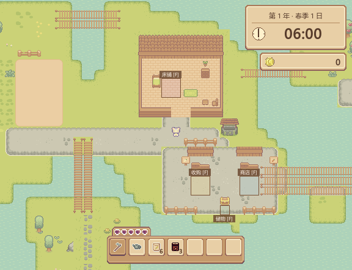

# 右上角日期、时钟与金币（2026-11-15）

用户要求移除顶部绿色整条栏，改用类似星露谷的右上悬浮时钟并显示金钱。
基线为 `f98eba7`，增量任务 `HUD-UI-001`，本地分支 `lxk-sleep-integration`。
本增量与滚轮、花草覆盖修复一并按用户要求交付到 `lxk` 分支。

## 布局和数据来源

576×442 逻辑画布大小保持不变，地图从原先 y=34、高408改为从 y=0 铺满442。
顶部绿色栏不再创建。右上角悬浮 HUD 为168×108，距右边和顶部均8逻辑像素。
上面板显示年份、季节、日期、24小时数字时间和同步的钟面指针；下面板显示金币图标和数量。
数字使用分组分隔符，长日期与金币按可用宽度缩小字号；保留完整值。
底部七格物品栏保持居中和距底边8像素，不改变格位、选用、拖动或存取规则。
原顶部的背包容量不再常驻显示，容量规则仍保持不变。

`FarmHud` 是展示控件，只消费主窗口提交的日期、时刻和金币快照。
时钟仍来自 `GameClock`，金币仍来自 `EconomyService`；绘制不结算、不写存档。
HUD 独立于地图镜头，位于夜色之上、睡眠/换季过渡之下。
控件不获取键盘焦点，点击面板不会穿透到地图触发农具；其他地图区域照常操作。
窗口缩放和高 DPI 沿用当前画布的等比缩放规则。

## 星露谷参考

实际查阅第三方反编译提交 `5225ef4` 的
`Stardew Valley/StardewValley.Menus/DayTimeMoneyBox.cs`：
`updatePosition()` 每次按 `uiViewport.Width` 和顶部边距定位，
`draw()` 读取日期和时间显示，`drawMoneyBox()` 独立绘制金币并读取玩家真实余额。
采用其“视口右上定位、日期时间同组、金币位于下方、与镜头分离”的布局逻辑。
本项目以 Qt Widgets/QPainter 和已有 Sprout 素材实现；现有24小时制、季长、睡眠及经济规则不变。

## 素材和文件窗口

面板对已有 `:/farm-ui/slots.png` 的 `(2,98,44,44)` 浅色框作九宫格绘制，保留像素边角。
金币图标使用本地 Sprout Lands Premium UI Pack 的
`UI Sprites/Icons/special icons/coins.png`，原样复制为 `resources/ui/hud-coins.png`，
通过 QRC `:/farm-ui/coins.png` 加载，采样 `(0,16,32,32)`。
只增加实际选用的小图，保留原作者和 Premium UI 包许可记录。

当前会话按用户授权顺序支援 C/E 的 `src/app/mainwindow.*` 和
`src/ui/farmhud.h`、A 的 `src/game.pri` / `character.qrc` / 图标资源、
共享 `tests/clock_ui/clock_ui_tests.cpp`，更新相关文档与此截图。
没有并行编辑者；接口仅为展示调用，不更改 B 农田、D 经济/存档服务。
团队消费者审查仍待完成，自测不代替成员审查。

## 验证

Windows Qt 6.8.2 / MinGW 13.1，Release 主程序构建成功。
九组测试重新构建并执行，348项通过、0失败、1项条件跳过（包含初始化/清理）：
时钟45、经济15、农具180、整局30、面板9、存档25、过渡17、季节4、核心23。
跳过项是原有无默认音频输出专项，本进程有默认设备，不符合该用例前提。
默认 DPI 的布局和 HUD 专项6项通过（包括初始化/清理）：小于画布窗口、中间比例窗口、
较大窗口，以及金币刷新、最大 int 金币、长日期、点击不穿透和夜间可读性。
同一专项在 `QT_SCALE_FACTOR=1.5` 下另测6项通过，并目视核对高 DPI 渲染图。
通过实际控件渲染图目视检查像素边框、文字和物品栏位置。
这些是离屏 Qt Test 交互与截图，不是原生桌面人工试玩。
