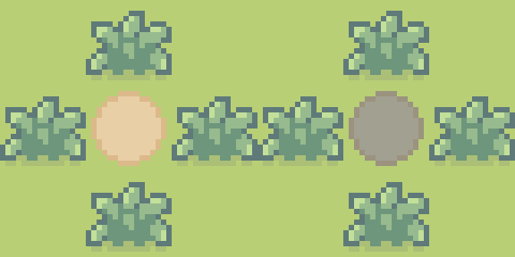

# 滚轮跳过空格与花草覆盖修复（2026-11-15）

用户要求滚轮只在实际有物品的物品栏格子之间循环，并反馈花草旁的新耕地看起来错误连片。
本次在 `f98eba7` 基线及尚未提交的右上 HUD 工作之上，支援 C 的
`src/ui/itembar.cpp`、`src/map/maprenderer.h/.cpp`、共享 `tests/farm_controls_tests.cpp`
和本文/开发入口文档；没有并行编辑者，不改地图、经济、存档、植物数量或日期规则。
此前 HUD 改动保留，本增量按用户要求与其一并交付到 `lxk` 分支。

## 滚轮

实际参考第三方星露谷反编译提交 `5225ef4` 的
`Stardew Valley/StardewValley/Game1.cs` 中 `pressSwitchToolButton()`：
按滚动方向更新物品栏索引，循环跳过 `CurrentItem == null` 的格子。
本项目将范围适配为首排七格，每次有效滚轮事件移动到下一个实际有物品的格子。
补充修正：按原作只取滚动方向，不将单次事件的多刻度值重复执行。只有第1、3格有物品时，
旧版单次±240事件会绕回第1格；新增回归已复现该失败。修正后±120/240/360/1200均只切换
一个非空格，连续两个事件才切换两次。触控板小增量仍累计到阈值再切换。
保留原有滚动方向、触控板小增量累计和面板期间的输入阻止规则。

- 只有第0、1格有物品时，从第1格向后滚回第0格。
- 物品移到第6格时，中间空格会跳过，反向滚动同样循环。
- 只有一个物品时保持选中它；整排空时保持空手，不死循环。
- 手动切换空手后，向后滚选第一个有物品格，反向滚选最后一个。
- 点击、拖动和背包格位规则不变，滚动不移动或消耗物品。

## 花草与耕地

核对 `HoeDirt.cs` 的 `gatherNeighbors()`：原作只将相邻 `HoeDirt` 加入邻接列表。
本项目既有四向掩码也只读 cultivatedLayer，未复现“花草邻格被当成耕地”的判断错误。
新增测试确认花草放在四个邻格时，中心耕地的16×16绘制结果与孤立耕地相同。

实际复现的是另一处绘制问题：地图花草装饰层位于耕地之后，锄地后该格原有的草地贴片、
小花草继续覆盖耕地。修复前真实素材回归 `flowersDoNotJoinOrCoverSoil` 在同格覆盖断言失败，
修复后通过。

修复只在已有耕地的格子上略过对应的静态地表装饰：`Grass.tsx` 图块，以及当前地图使用的
`Mushrooms, Flowers, Stones.tsx` local 25–27（GID300–302）小花草。
下层可耕草地仍正常绘制，旁边的花草不移除，石头、桥、围栏、建筑和家具不作为花草隐藏。
作物仍由独立作物层绘制；干湿耕地沿用同一轮廓。仅改变展示，装饰未从地图数据删除，
耕地恢复后原装饰可重新显示；没有新增图块编号或改变存档。

若反馈涉及另一种位置或装饰，新图块需按实际素材继续核对，不能据此宣称所有视觉连片原因均已定位。

## 验证

Windows Qt 6.8.2 / MinGW 13.1 Release 主程序重新构建成功。九组回归共350项通过、
0失败、1项条件跳过（含初始化/清理）；跳过项为原有无音频输出测试，本进程有默认设备。
分组为时钟45、经济15、农具182、整局30、面板9、存档25、过渡17、季节4、核心23。

新增滚轮稀疏格位与花草叠层回归。农具/地图套件已通过182项（含初始化/清理），
保留已有16种干湿邻接组合、移除邻格、透明圆角、拖动及输入屏蔽测试。
进一步验证同格花草覆盖、邻格花草保留、浇水、空地恢复以及围栏不被隐藏。
渲染预览由真实素材生成 `captures/soil-near-flowers.png`；桌面人工试玩尚未执行。

1.5倍 DPI 的新增两项专项另测4项通过（含初始化/清理）。已目视检查下图：
左为干土、右为湿土，四周均为花草，中心仍为独立地块。

### 第1、3格补充回归

上一轮将多刻度事件重复循环，导致只有两个非空格时±240会返回原格。
新增 `wheelCyclesFirstAndThirdWithLargeDeltas` 先在旧代码复现失败，再验证修正：
第1→第3→第1，两个方向、多刻度及触控板输入均通过，库存未变。
本次主程序重建成功，完整农具/地图套件183项通过；此前其他八组结果仍为上轮记录，
未因这次仅滚轮分支修改重复运行全部套件。
