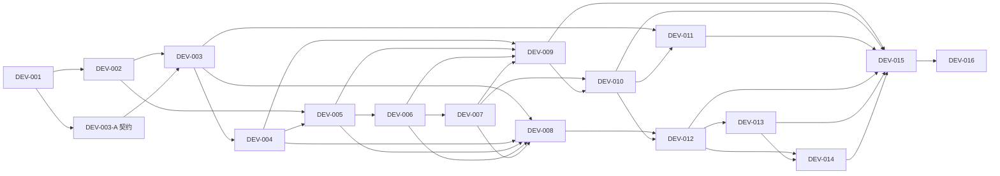

# 五人执行计划

v0.2，沿用 [DEVELOPMENT](DEVELOPMENT.md) 的 DEV-001–016 与 M0–M4。以下为未来执行计划，本轮文档完成不等于这些业务任务完成。A–E 对应 [TEAM_MODULES](TEAM_MODULES.md)。没有工时信息，工作量用 S（单域局部）、M（单域完整行为）、L（跨域闭环）；不能将等级换算为承诺天数。

## 1. 阶段门与并行安排

| 阶段 | 交付门槛和可运行状态 | A | B | C | D | E |
| --- | --- | --- | --- | --- | --- | --- |
| 0 工程基线 | DEV-001：原型构建/Qt Test/GUI 记录；失败列清单，不凭历史记录通过 | Kit/构建证据 | 农田行为核查 | 地图、音频、输入核查 | 收获计数与容量缺口场景 | 原型回归场景/现有测试盘点 |
| 1 工程化基础（M0 前置） | DEV-003-A：IC-01–09 的 M0/M1 子集冻结并建立最小契约头/fixture；现有原型继续运行 | 公共头、只读状态/事务骨架、模块构建注册 | 审状态/生长接口、作物样例 | 坐标/输入迁移清单 | 库存/经济错误用例 | 跨模块场景、物流字段评审，不实现机器 |
| 2 M0 整理 | DEV-002/003：单命令输入、语义两作物，原型可运行；此时有限背包尚未验收 | 时钟/控制器/状态 | WorldState/FarmSimulation | W1/W2/W3 迁移 | 按契约准备库存实现，不越过集成门 | 检查规则回归与 fixture |
| 3 M1 闭环 | DEV-004–009：种收装包、走到站、卖、五升级、重启恢复；最小可读 UI | 存档/装配 | 安全采收/首轮升级效果 | 站点/HUD/最小面板 | 库存/出售/购买 | tests/integration 与保存完整性复核 |
| 4 M2 手动成长 | DEV-010/011：范围/排播/灌溉/扩地、四作物行为、完善中文 | 配置兼容、构建 | 范围和再生 | 字体/预览/地图反馈 | 升级表与收益核对 | M3 状态表、事件与在途 fixture；无自动业务提前上线 |
| 5 M3 自动化 | DEV-012–014：箱体、补种、运输/代售、在线离线守恒 | 推进协调/存档升级 | 共享生长/采收能力 | 设施/路线与停工显示 | 复用转移/出售 | 自动化与物流主实现 |
| 6 M4 打磨 | DEV-015/016：新玩家体验、错误恢复、独立部署包 | 发布/回滚 | 农田回归 | 引导/窗口/声音 | 实际到账调参 | 自动链路回归与守恒报告 |

契约冻结前可以写需求、测试表、资源草图；**正式实现并行**需要公共签名/类型已合入 main。使用真实服务和小 fixture 优先于模拟一整套经济系统。C 不等待 D 完成才设计布局，但交易按钮接入验收必须等正式接口。E 早期承担回归/集成测试，不占用 B/D 实现文件。

## 2. 通用 Definition of Done

以下 G-DoD 适用于每个任务，任务表的“完成”是额外条件：

1. 达到本行功能与人工验收，自动测试记录命令、提交 SHA、Kit、结果；没执行须明确，不得标完成。
2. 文件符合所有权，消费接口版本一致；跨域消费者审核通过；无新双写状态或绕过命令入口。
3. qmake 应用及受影响测试构建成功；提交实际执行的测试结果；GUI 变化有操作记录/截图，逻辑变化有资产/边界断言。
4. 现有原型不退化；资源路径有效；存档/配置变动有版本与兼容测试。
5. 文档实际状态、待决项和已知问题更新；PR 合并到 main，最小 CI 通过（CI 启用前由 A 记录等价本地检查）。

文档型子任务仅做 Markdown/契约审阅，不要求写镜像测试。程序运行/构建检查属于后续阶段 0，本轮权限仅文档，因此不冒充已经完成。

## 3. DEV 父任务：范围、文件和依赖

下表每行是独立任务卡。文件是将要修改的清单：M0 未搬迁时使用 [迁移映射](DIRECTORY_STRUCTURE.md) 的原路径，禁止同时维护两份。各主责只修改其自有文件，协作人实施自己归属部分；“并行”只允许前置/契约满足后的开发或标明的准备工作。

| 编号/阶段/量 | 模块与主责（协作） | 目标和具体实现；交付物 | 文件/目录 | 接口 | 前置与并行 |
| --- | --- | --- | --- | --- | --- |
| DEV-001 / M0 / M | A（全员） | 可重复 Kit/构建/启动基线；记录历史/本轮差别，建立失败清单 | docs/TEST_STRATEGY.md、README；以后 CI 配置由 A | 现有 GameClock/WorldState API | 无；五人并行读各自域 |
| DEV-002 / M0 / L | C（A/B） | W1 唯一坐标转换、输入去重、矩形/负坐标/角色边界；保留移动动画 | mapwidget.*、playercontroller.*、rpg.*、collisiondetector.*、mainwindow.*；目标 viewtransform.*、moverules.*、tests/player | IC-02/09 | 001；与003-A、D/E用例准备并行，不与他人改同一旧文件 |
| DEV-003 / M0 / L | A（B/C） | GameState/事务/Controller/时钟接线；B 语义地块与两作物；C 只读视图；W2/W3 迁移 | src/core、gameplay/gamecontroller.*、gameplay/farm、C 绑定文件、data/crops.json、render_mapping.json、tests/core/farm | IC-01/02/03/06/07/09 | 002 + 003-A；A/B/C 独占文件并行，绑定按窗口合并 |
| DEV-004 / M1 / L | D（B/C/E） | 有限背包和整格容量采收；B 接入 D，C HUD；交付守恒集成测试 | economy/inventoryservice.*、core/inventorystate.h（A）、farmsimulation.*（B）、ui/panels/hud.*（C）、tests/economy/integration | IC-01/03/04 | 003；库存内部可在003-A后准备，集成不能越过003 |
| DEV-005 / M1 / M | C（D/A） | 可达市场语义、E 面板交互、范围提示/输入屏蔽 | ui/map/mapdata.*、mainwindow.*、gamepanels.*、map6.tmj、character.qrc、tests/ui | IC-02/05/09 | 002、004；D 准备006交易规则，C 只改地图/UI |
| DEV-006 / M1 / L | D（C/E） | 金币、报价、单类/全部出售、执行时权限和原子成交、错误反馈 | economy/economyservice.*、data/economy.json、gamepanels.*（C）、tests/economy/integration | IC-02/04/05 | 005；与008存档 schema准备、009布局准备并行 |
| DEV-007 / M1 / L | D（A/B/C） | 升级配置与五项强化：高产、土壤、三格、扩容、首次扩地；前置/效果原子 | data/upgrades.json、economyservice.*、definitions.h（A）、farmsimulation.*（B）、gamepanels.*（C）、tests/economy/farm | IC-03/04/05/07 | 006；各域效果独占文件并行，跨域同事务集成 |
| DEV-008 / M1 / L | A（E及各域审） | 版本存档、校验/备份/错误恢复、保存位置与全部已实现状态 | persistence/savemanager.*、core/gameruntime.*、tests/persistence、fixtures/persistence | IC-01/06/07/08 | 003–007；schema/往返测试可在003后开始，完成等007 |
| DEV-009 / M1最小、M2完善 / M | C（D/A） | 字体比较与选型、可读背包/交易/商店、图集切片、容量金额无截断 | ui/assets/*、ui/panels/*、resources/ui.qrc、fonts/*、ASSET_AUDIT、tests/ui | IC-02/05/09 | 004–007；布局/字样比较可提前，正式接入后验收 |
| DEV-010 / M2 / L | B（C/D） | 排播、更大范围收割/水壶、灌溉、后续扩地及统一预览 | gameplay/farm、data/upgrades.json（D）、ui/map/预览（C）、tests/farm/player | IC-02/03/05/09 | 007、009；C表现和B规则按 targets 接口并行 |
| DEV-011 / M2 / M | B（C/D） | 追加作物差异和有限再生；图帧/售价联动 | data/crops.json、farmsimulation.*、render_mapping.json（C）、tests/farm | IC-03/07 | 003、010；与 E 的M3状态/fixture准备并行 |
| DEV-012 / M3 / L | E（A/B/D/C） | 设施摆放/启停、覆盖、吞吐、有限采收箱、成功补种；正式自动化接口复核 | logistics/automationsystem.*、data/facilities.json、logisticsstate.h（A）、ui设施表现（C）、tests/logistics | IC-03/04/06/10 | 008、010；与011可按原依赖并行，但再生接入须加兼容测试 |
| DEV-013 / M3 / L | E（D/C） | 田边代售、固定路线、装车/在途/到站结算、保留货、延后改线 | logistics/transportsystem.*、data/facilities.json、ui路线表现（C）、tests/logistics/integration | IC-04/05/06/10 | 012；D复核通用交易，C独立动画，不在动画中结算 |
| DEV-014 / M3 / L | A（E主协作/B/D） | 同一推进器离线处理、自动化存档版本、在途恢复/重试、能力限制 | core/gameruntime.*、persistence/*、logistics事件查询（E）、tests/persistence/integration | IC-06/08/10 | 012、013；A/E分文件并行；必须集成真实B/D规则 |
| DEV-015 / M4 / M | C（D/E/B/A） | 教学、首次收获/出售/扩容/自动循环体验记录，按实测调参 | ui/panels/hud.*、docs/试玩记录、data各域由其主责修改、tests/integration（E） | IC-02/05/07 | 009–014全部；多人按角色试玩并行，一次主要数值变量 |
| DEV-016 / M4 / M | A（C/E/B/D） | 警告清单、部署依赖、发布包/备份/回滚与完整回归 | CHECK.pro、构建/CI配置、README/验证报告，各域修各自警告 | 全部已冻结接口 | 015；清理和打包测试可分工，最终单一发行基线 |

## 4. DEV 父任务：测试与验收

各行完成判定 = G-DoD + 本行自动检查、人工验收均有证据。未明确的数值/资源选择只阻塞依赖该选择的交付，不允许先假定并宣称完成。

| 编号 | 自动测试/检查（未来执行） | 人工验收/完成判定补充 |
| --- | --- | --- |
| DEV-001 | 当前应用干净构建；core_tests 的5个功能函数；QRC 路径扫描 | 启动地图/行走/种收/声音、记录已知问题；不能只依据测试存在 |
| DEV-002 | 坐标往返、负值、QRect精确边缘、组合键事件、一次点击不连种收 | 相机滚动/边缘点击无越界，角色边界正常，工具动画保留 |
| DEV-003 | 语义成熟与GID无关、两作物各自时长/产量、事务失败不变、暂停恢复 | 同一地图仍可玩，两作物可辨；旧状态仅派生不双写 |
| DEV-004 | 剩2收3失败、恰好装满、范围部分成功、两次采收、容量溢出 | 满包留田可去卖，HUD立即反映实际数量 |
| DEV-005 | 非法市场/不可达交互区、面板输入穿透、远程请求拒绝 | 角色能走到标记，E开关与恢复焦点；远处不展示可成交入口 |
| DEV-006 | 单类/全部、保留品、负数/不足/溢出、两次SellAll、执行时重验距离 | 出售后物品减少量/金币增量可核对，空包不会加钱 |
| DEV-007 | 五效果、前置/满级/余额不足、扩地幂等、非法效果整单回滚 | 每项购买有可感知变化，未成熟作物产量快照不变、速度不重置进度 |
| DEV-008 | 大整数往返、坏档/备份、版本/ID不兼容、保存I/O失败、快照完整 | 关闭重开位置/背包/等级/作物一致；错误提示不覆盖好档 |
| DEV-009 | 字符覆盖/资源加载、点击信号、不同长度文本布局断言 | 关键汉字与数字混排可读，1/2倍及高DPI检查；最终字体来源登记 |
| DEV-010 | targets顺序、越界过滤、范围部分成功、浇水/喷灌同档不叠、移除覆盖 | 预览与实际命中一致；范围工具确实减少点击；首次扩地不重复售卖 |
| DEV-011 | 再生计数耗尽、下一轮补种资格、不同生长参数与产量 | 快熟/多产/长周期/再生均可观察；图集映射正确 |
| DEV-012 | 满箱停工恢复、覆盖重叠、手动/自动同格、移动冷却、仅成功后补种 | 设施有工作/停工反馈，不借个人背包、不清未熟作物 |
| DEV-013 | 源箱+货舱+已售守恒、未到站零收入、重复到站、预留、在途改线 | 看得见运输与到账，代售只卖卸入该箱货物 |
| DEV-014 | 同初态同时间在线/离线相同；无运输/无采收；负UTC；载货恢复；离线保存失败 | 重启不重复卖；离线结算明确，失败可重试且不可继续累计 |
| DEV-015 | 调参后重跑相关规则；事件记录实际到账不代替产值 | 新玩家能说清亲自出售/扩容/自动化收益；试玩表有瓶颈与改动依据 |
| DEV-016 | 应用/全部测试、资源扫描、部署包启动检查、存档恢复回归 | 无开发Qt路径的环境可启动，地图/音频/中文/关闭恢复合格；发布物可定位提交 |

## 5. 为早期并行拆出的子任务

父任务仍需满足原依赖并整体验收。子任务只提前交付准备件，不借“接口准备”提前上线未安排业务。下列每项同样使用 G-DoD（文档项仅文档检查）。

| 编号/阶段/模块/主责/量 | 具体交付与文件 | 接口/前置/并行 | 自动验证 | 人工与完成 |
| --- | --- | --- | --- | --- |
| DEV-001-E / 阶段0/M0/E/S | 复核现有测试范围，记录跨域场景及缺口；docs/TEST_STRATEGY.md 的变更由A合并，E提供评审记录 | 现有API；无；与001其他基线核查并行 | 文档链接和用例可追踪 | A/B/C/D确认未把未测项标通过 |
| DEV-003-A / 阶段1/M0/A/M | 公共类型、只读快照、候选事务和命令头最小骨架；core/*.h、gamecontroller.h、tests/core最小fixture；此代码属于未来阶段1 | IC-01–09 M0/M1子集；001；可与002并行 | 头文件可独立编译、业务头无Widgets/QPixmap、候选失败不影响原态 | A及B/C/D/E确认接口revision；只冻结必需字段不实现未来机器 |
| DEV-008-E / 阶段3/M1/E/M | 对真实收获/出售/存档做跨域fixture与集成测试；tests/integration、fixtures/logistics以外的本任务专用目录 | IC-03/04/05/08；004、006及008可测候选接口；与A写存档并行 | 满包/到站/往返快照完整 | A/B/D审查资产守恒，问题归还原负责人修 |
| DEV-012-E / 阶段4/M2/E/S | 自动化状态表、事件顺序样例、货舱/冷却存档样例文档；docs/INTERFACE_CONTRACTS.md由A主责合入，E负责提案 | IC-06/08/10；008、010；与011并行 | 样例JSON若有则解析、状态转移表覆盖 | A/B/D确认M3契约；无正式调度/收益实现 |

## 6. 任务依赖图

图保持原父任务依赖；003-A 是提前准备，不解除 DEV-003 对 DEV-002 的集成依赖。M1 的 UI 原型准备和存档 schema 准备可提前，验收必须等各自依赖。

关键路径是契约/状态→背包→市场→出售→升级→存档/范围→采收→运输→离线→打磨；主要风险是 A 公共接口和 C UI 同时拥堵。缓解方式为小接口先合、分文件窗口、E 前期承担测试；不靠五人同时改 MainWindow 追求表面并行。后续订单/加工没有首版 DEV 任务，另建后续编号前先确认范围。
