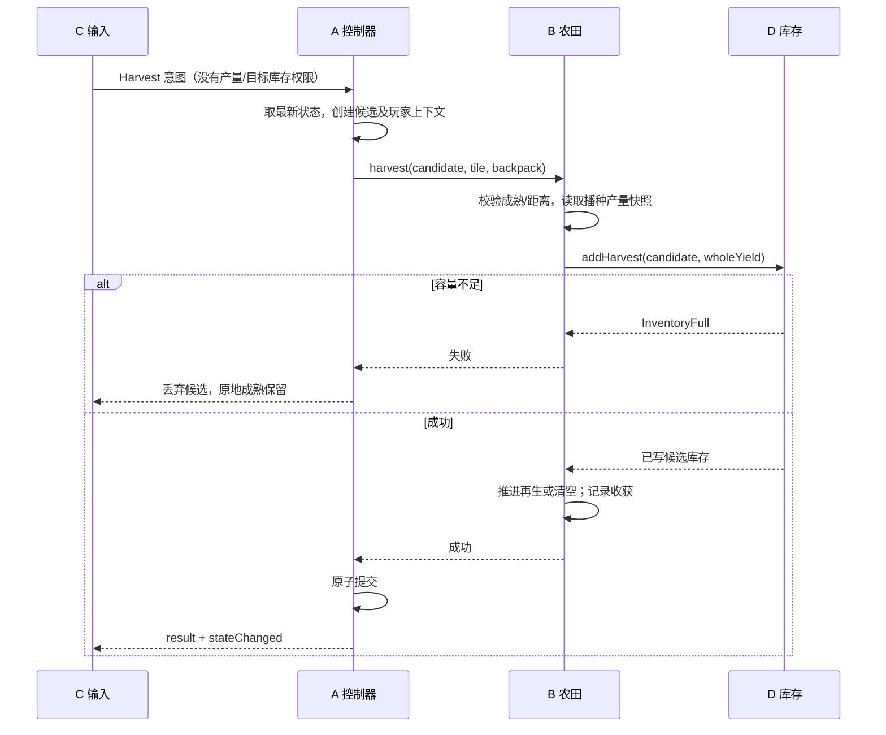
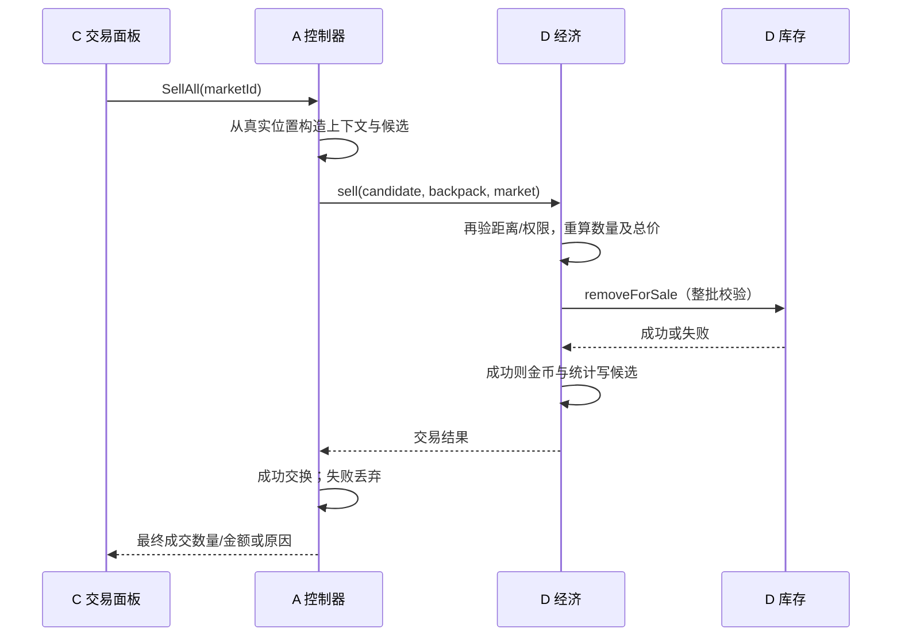
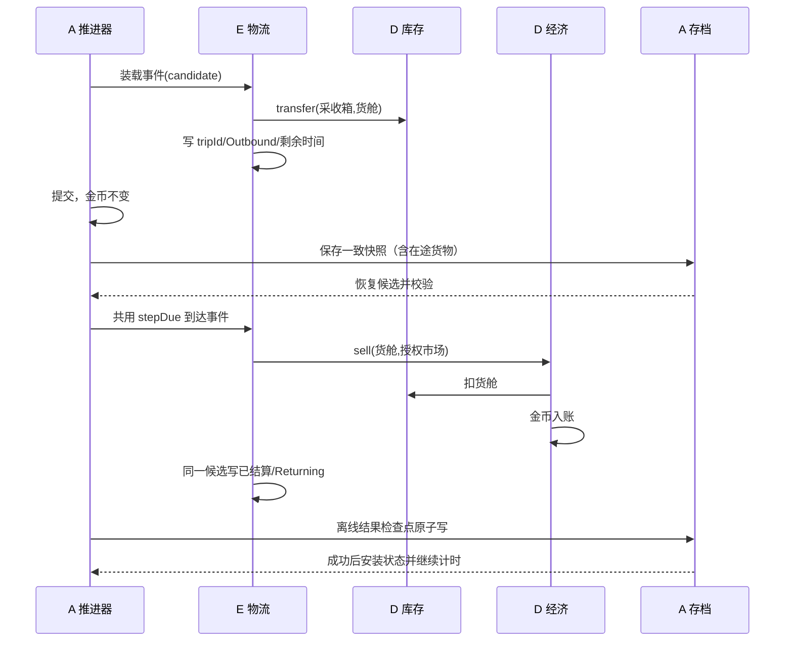

# 模块接口契约

v0.2 工程草案。以下是头文件级设计，**并未创建对应 C++ 文件，也不是可直接编译的完整声明**。阶段 1 冻结 M0/M1 契约后再实现；M3 接口在 DEV-012 开工前复核。所有类型路径见 [目录规划](DIRECTORY_STRUCTURE.md)，主责见 [所有权](FILE_OWNERSHIP.md)。

## IC-01：唯一状态与原子提交（A，所有成员必审）

头文件 `src/core/gamestate.h`、`src/core/transaction.h`、`src/core/types.h`。A 的 GameRuntime 拥有一个 GameController；控制器拥有唯一活动 GameState、服务和只读 DefinitionCatalog。窗口在 runtime 之后销毁，runtime 存活期覆盖全部命令。服务不拥有活动状态指针，只在同步调用期间借用候选事务。快照按值返回，不允许 UI 缓存可写引用。

```cpp
// 伪代码：普通 C++17/Qt Core 值类型；不包含 QWidget/QPixmap。
using Quantity = qint64; using Coins = qint64; using SimTimeMs = qint64;
using ItemId = QString; using InventoryId = QString; using CropId = QString;
using MarketId = QString; using UpgradeId = QString; using FacilityId = QString;
using RouteId = QString; using RequestId = QString;
struct TilePos { int x; int y; }; // 与像素坐标是不同类型
struct WorldPos { int x; int y; }; // 角色锚点：沿用精灵左上角，脚部矩形单独定义
enum class ErrorCode {
    Ok, OutOfRange, InvalidTile, Occupied, NotMature, NotUnlocked,
    InventoryFull, InsufficientItems, InsufficientCoins, ReservedItems,
    MaxLevel, InvalidQuantity, InvalidDefinition, Overflow, InvalidState,
    Unauthorized, Busy, StaleRequest, IoError, UnsupportedVersion
};
struct CommandResult {
    RequestId requestId; ErrorCode code; quint64 revision;
    Quantity moved; Coins coinsDelta; QVector<TileResult> tiles;
};
class GameState {
public:
    GameSnapshot snapshot() const; // 只读值，包含 revision
private:
    // PlayerState、FarmState、Inventory/EconomyState、LogisticsState、时间/版本
    // 无公开 mutable accessor；仅 Transaction/控制器允许构造和交换。
};
class Transaction {
    // 构造/commit 仅 GameController；其余服务拿到引用不能 commit。
    // 私有 farmWrite() 仅 friend FarmSimulation；inventoryWrite() 仅
    // InventoryService；economyWrite() 仅 EconomyService；logisticsWrite()
    // 仅 AutomationSystem/TransportSystem；playerWrite() 仅控制器。
};
```

`Transaction` 只是小型候选状态封装，不做通用数据库事务。活动状态串行排他；候选复制来自最新 revision。A 校验跨域引用和资产范围，成功交换全部候选、revision 加一，再发通知；失败丢弃候选。B 必须通过 InventoryService 增加库存，EconomyService 也必须经 InventoryService 扣库存。受限写句柄构造私有、不可复制、不能保存到服务字段；public API 不暴露原始可写子域。C 和普通 UI 测试拿不到它。

每个请求在 GUI 线程队列处理；执行中再次提交只排队，不进入嵌套事件循环、不 processEvents、不弹模态框。失败不发 stateChanged。状态通知仅含 revision/变更 ID，不含可写引用；UI 槽更新显示，可排下个请求但不能重入提交。

程序内 RequestId 由输入适配为每次意图生成，重复投递同一 ID 返回缓存结果不再执行；缓存会话内有效，存档不恢复 UI 请求队列。每次新意图生成新 ID，不能阻止正常重复种收。物流不依赖此缓存去重，而是持久化 tripId/阶段保证恢复正确。

### 核心字段与单一写入者

| 状态/定义 | 公共头 | 必要字段 | 唯一业务写入者 |
| --- | --- | --- | --- |
| PlayerState | playerstate.h | 世界位置、朝向、工具、选种、backpackId | A 提交 C MoveRules 的验证结果 |
| FarmState/PlotState/CropState | farmstate.h | 稳定地块 ID/坐标、解锁/耕地、cropId、进度、播种时产量快照、剩余收获次数、成熟时刻、照料 | B |
| InventoryState | inventorystate.h | id/kind、capacity、item→数量与保留量 | D InventoryService |
| EconomyState/Progress | economystate.h | coins、升级等级、解锁、累计收获/出售、教学赠送标记 | D；新局/恢复由 A 经校验构造，业务累计通过 D 记录 |
| Facility/TransportState | logisticsstate.h | id/type/占地/覆盖参数引用、inventoryId、启停/下次事件；route/source/market/cargo/tripId/阶段/剩余时间/待改路线 | E |
| 定义 | definitions.h | CropDefinition、UpgradeDefinition、EffectiveEffects、FacilityDefinition、MapDefinition | 初始化后不可变；来源由 B/D/E/C 分别提供、A 校验装载 |
| 系统元数据 | gamestate.h | schemaVersion/configVersion/mapVersion、累计生产 ms、revision、保存 UTC、暂停状态 | A |

WorldState 在迁移期只包装 GameState 的 FarmState 视图/受限句柄，不能再按值保存另一套地块。Snapshot 是不可变展示副本，不是可独立结算的游戏实例。

运行容器顺序不是规则顺序；不得依赖 QHash 遍历顺序。金额、数量、容量都检查加减乘溢出及非负；配置拒绝单格最大产量超过可获得背包容量的组合。qint64 存档采用十进制字符串。没有第二个“全农场总库存”资产字段；汇总按快照计算。

## IC-02：UI 命令、查询与事件（A；C/B/D/E 审查各自命令）

头 `src/gameplay/gamecontroller.h` 和 `src/core/commands.h`。

```cpp
class GameController : public QObject {
public:
    RequestId submit(const PlayerCommand&); // 排队，返回关联 ID
    GameSnapshot snapshot() const;
    PreviewResult preview(const PlayerCommand&) const; // 无写入、非成交承诺
signals:
    void commandFinished(CommandResult result);
    void stateChanged(ChangeSet changes); // 成功提交后一次
};
// PlayerCommand：SetMoveInput(direction/pressed)，SelectTool，Cultivate(tile)，
// Plant(tile,cropId)，Harvest(target,pattern)，Water(target,pattern)，
// Sell(marketId,item/全部,quantity)，BuyUpgrade(id)，Transfer(src,dst,item,count)，
// Place/Move/ToggleFacility，ConfigureRoute，Pause/Resume。
```

只接收意图，不接受“新金币”“本次产量”“我在市场旁”“我是自动设施”等值。内部 MoveIntent 的 elapsedMs 来自受控 runtime tick，普通 UI 不得伪造任意时长或绝对位置；UI 只改变按键状态。手动 Harvest 目标库存固定为玩家 backpackId；设施来源和权限由控制器内部生成，不能从面板传入。

执行时从活动状态解析 ActorContext：玩家脚部格/工具/解锁，或已存在设施的 coverage/source/route。市场位置与交互格来自 MapDefinition。UI 的预览与执行复用规则查询，提交前重新检查；`StaleRequest` 表示需刷新，不允许用旧报价扣资产。面板阻止输入穿透，普通面板不暂停生产，暂停菜单经控制器停生产与移动。

最小验收：假 UI 连发重复 requestId，只获得一次资产变化；无效权限或远处出售失败；连接 stateChanged 再提交的命令排队而非重入。测试替身实现同一 facade 的最小请求/查询/通知协议，可固定返回数据，不能在替身另写余额算法；具体是否抽窄虚接口在阶段 1 决定，默认实际服务 + 小 fixture 即可。

## IC-03：农田服务（B；D/E/C 消费）

头 `src/gameplay/farm/farmsimulation.h`，旧 `worldstate.h` 渐进迁移为语义状态承载，最后挂入 GameState。

```cpp
Result cultivate(Transaction&, TilePos, const ActorContext&);
Result plant(Transaction&, TilePos, CropId, const ActorContext&);
HarvestResult harvest(Transaction&, TilePos, InventoryId destination,
                      const ActorContext&, InventoryService&);
Result water(Transaction&, const QVector<TilePos>&, const ActorContext&);
Result unlockRegion(Transaction&, RegionId); // 只能被已验证购买事务调用
Result advance(Transaction&, SimTimeMs from, SimTimeMs to,
               const EffectiveEffects&, const CoverageSnapshot&);
QVector<TilePos> targets(const GameSnapshot&, TargetRequest) const;
std::optional<SimTimeMs> nextMaturityTime(const GameSnapshot&, const EffectiveEffects&,
                           const CoverageSnapshot&) const; // 无事件返回显式 none
```

耕地/种子/工具权限、距离、成熟等校验后才写 farm；收获先算本轮固定产量，调用 D 入库，成功才清除或推进再生、记录累计收获。B 通过 D 的进度记录方法更新统计，不直接写经济子域。失败返回 InventoryFull/NotMature 等，不改农田。再生未耗尽则进入下一周期，不返回可补种状态；耗尽才返回 `becameEmpty=true`。E 收到成功结果且能力启用后调用同一 plant，禁止 harvest 内无条件补种。

范围 targets 手动按距中心、y、x 排序；机器按成熟时间、y、x；排序规则来自玩法设计。范围每格独立候选提交，失败格保留并继续后续可容纳格，CommandResult.tiles 包含逐格结果，不能只返回笼统成功。生长以语义进度判断成熟；渲染 GID 不参与合法性。升级不重置进度，产量下一播种生效。

最小测试：剩余容量 2/整格 3 无变化；同格两次采收一次成功；高产升级不改在田快照；再生剩余次数正确；负坐标拒绝；B 测试使用真实 D 服务与微型内存 fixture，无 QWidget。

## IC-04：通用库存（D；B/E 消费）

头 `src/economy/inventoryservice.h`。

```cpp
InventoryView view(const GameSnapshot&, InventoryId) const;
Result addHarvest(Transaction&, InventoryId, ItemId, Quantity, const ActorContext&);
Result transfer(Transaction&, InventoryId from, InventoryId to,
                ItemId, Quantity, const ActorContext&);
Result removeForSale(Transaction&, InventoryId, const SaleLines&, const ActorContext&);
Result resize(Transaction&, InventoryId, Quantity newCapacity);
Result reserve(Transaction&, InventoryId, ItemId, Quantity, const ActorContext&);
```

物品全部储存在 GameState 的按 ID 库存；kind 至少 Backpack/Collection/Consignment/Cargo。addHarvest 只允许 B 的内部采收上下文；不能成为 UI 任意赠送接口。transfer 两端存在且不同、合法权限、正数量、不超过可移动数和容量，整次转移原子。按剩余空间取部分货由调用者先查询可取量再提交具体数量，执行时仍复核；不会静默少转。

保留数是库存内不可出售/不可自动装载部分，`0≤reserved≤quantity`。有意手动转移保留品的语义尚待后续订单任务确认，首版建议拒绝转移保留部分，不能隐式解除预留。resize 不得小于已占用；capacityPerItem 来自定义，工具/金币/永久种子不进入农产品库存。

最小测试：源减=目的增；零/负数/溢出/相同库存/未知 ID 拒绝；满箱整次不变；保留量不超库存；所有失败断言快照等于调用前。

## IC-05：经济、升级与效果（D）

头 `src/economy/economyservice.h`；类型在 `src/core/definitions.h`。

```cpp
Quote quote(const GameSnapshot&, MarketId, SaleSelection) const;
Result sell(Transaction&, InventoryId, MarketId, SaleSelection,
            const ActorContext&, InventoryService&);
PurchaseResult buyUpgrade(Transaction&, UpgradeId, InventoryService&);
EffectiveEffects effects(const GameSnapshot&) const;
Result recordHarvest(Transaction&, CropId, Quantity); // B 成功采收后调用
```

sell 校验位置/来源权限、可卖类型、可用数量/保留数、checked 总价、金币上限；调用库存扣减，在同一候选增加 coins/累计出售。SellAll 先收集有序可卖清单、全量验证再一次提交；空清单返回 InsufficientItems。未到站的 cargo 无出售权限；代售必须有服务且到批次时刻；个人背包只接受手动到站上下文。

buyUpgrade 先校验前置/等级/价格/参数及跨域效果约束，扣款+等级写入候选，返回类型化效果。背包容量由 D 在同一事务更新；扩地由控制器调用 B.unlockRegion；设施解锁/购买由控制器调用 E 配置，任一失败全部回滚。速度/工具范围从等级计算只读 EffectiveEffects，服务按调用时效果读取，不用通知槽修改真实属性。效果跨域校验必须先预检，禁止付完款后才发现作物永远装不进背包。

任何服务返回失败都使所在候选事务失效，控制器必须丢弃，不能在半修改候选上忽略错误继续提交。范围操作独立创建下一格候选；系统同刻多个事件也分别创建候选，事件自身的库存/阶段必须一次提交。

首版整数基础售价不需小数。未来非整数倍率的统一取整策略仍待确认：建议总价最后一次向下取整，用整数分子/分母并检查中间乘法溢出；阶段 1 记录裁决后才能配置分数倍率。不能各模块自选取整。

最小测试：远程 sell 拒绝；重复 SellAll 第二次无收益；钱不足/满级/区域已解锁/效果非法不扣款；五项升级分别影响下一播种产量、即时速度、工具范围、容量、地块集。

## IC-06：时间与推进（A；B/E 审查）

头 `src/core/gameclock.h`、`src/core/gameruntime.h`。保留原 GameClock 日历换算，新增累计有效生产毫秒、pause/resume/restore 能力。单调时钟只采样增量，不把 QElapsedTimer 对象存档；UTC 只用于跨进程离线差值。

```cpp
SimTimeMs GameClock::takeDelta(); // 在线非负增量；暂停返回 0
void GameClock::pause(); void GameClock::resume();
Result GameRuntime::advanceTo(SimTimeMs target); // 在线/离线共用
```

推荐确定性顺序（工程提案，阶段 1 冻结）：先将生长推进到下一事件时刻；同刻先处理已有货舱到达结算、代售收购，再采收/成功补种，再装载新一趟，最后发布该时间点变化；同类按稳定 ID，地块按 IC-03。事件边界上的玩家命令排在该时刻系统事件之后。暂停不推进任何生产、设施、运输和移动；普通 UI 面板继续生产。render timer 仅绘制快照。

E 提供 nextEventTime/stepDue/coverage，B 提供 nextMaturityTime 和按区间推进；没有事件用 optional 空值，不能用0时间不断触发。A 选择下一最早事件而非逐帧跑数小时。零周期配置拒绝；满箱后允许下一正常周期再尝试，避免同一时间无限重试。离线分块执行保持事件顺序，禁止收益公式绕过箱体瓶颈。测试时注入明确的时间增量，无睡眠等待；同初态在线分段和离线整段结果应一致。

## IC-07：定义配置（A 基础设施，B/D/E/C 内容）

`src/core/definitioncatalog.h`：`load(paths) -> Result<DefinitionCatalog>`，`validate() -> QVector<DefinitionError>`。加载产物不可变；业务读引用，runtime 生命周期覆盖所有读取。错误包含文件、字段、ID、原因；不使用异常代表可预期业务失败。

CropDefinition 归 B 提供；D 提供价格/升级与经济配置；E 提供机器周期/容量/路线约束；C 提供地图语义和渲染映射。A 校验唯一 ID、正时长、正容量、交叉引用和升级前置无环；各域 validator 返回错误汇总。运行中调参首版要求重启并走版本兼容校验，不增加热重载系统。

data 文件通过独立 `resources/config.qrc`（未来）加入，不改变旧 character.qrc URL。业务配置只引用逻辑 ID；C 的渲染映射关联阶段到 GID/帧。新增作物/已有效果类型的升级走配置；全新机制仍需代码和契约测试，不承诺任意玩法都能零代码扩展。

## IC-08：存档与恢复（A）

`src/persistence/savemanager.h`：`save(const GameSnapshot&, path)`、`load(path, const DefinitionCatalog&) -> LoadResult`。读取返回独立候选，绝不边解析边改活动世界。运行主线程同步取得一致快照，先做小规模同步保存，耗时证据出现后才考虑后台序列化不可变快照。

保存版本/配置地图版本、时间、全部子域、稳定 ID 引用、在途货舱/剩余时间/tripId、机器冷却、预留、一次性赠送标记。QSaveFile 原子写，至少一份已校验备份；备份更新不能用损坏主档覆盖唯一好备份。未来版本拒绝覆盖，未知 ID 返回明确迁移错误。

恢复：读取→版本迁移→各域校验→构造候选与引用→只调用同一 advanceTo 执行一次离线→原子写入结算检查点→安装活动状态/重新绑定 C 视图→开启计时。负 UTC 差按 0，上限参数沿用试验值；没有运输不卖货，没有采收只成熟。写入失败保持恢复阻塞态，重试同一候选；不能继续游戏再从旧档重复领取。崩溃重读旧档并重算不造成持久化的二次发奖，因为新状态从未安装/允许游戏继续。

最小测试：大整数往返、坏主档/好备份、未来版本、未知物品、重复引用、磁盘失败、在途恢复、离线保存失败重试。

## IC-09：地图、移动与渲染（C，公共 MapDefinition 由 A 主责）

`src/ui/map/mapdata.h` 保留 MapLoader/MapData 渲染资源；导入输出 `MapDefinition`（尺寸、碰撞语义、地块/区域 ID、市场交互格），不带 QPixmap。`src/gameplay/player/moverules.h` 提供 `evaluate(PlayerState, MoveIntent, CollisionView, bounds) -> MoveResult`。A 只提交合法结果，C 的角色控件从快照更新动画和世界坐标投影。

`ViewTransform` 是窗口/视口/世界/图块转换唯一入口，负世界坐标在除法前拒绝。CollisionView 是一次调用的只读借用，替换状态后禁止保存旧向量指针。MapRenderer 接受 const 快照和 C 的 AssetCatalog，渲染缓存按 revision 失效，不回写农田。

`tooltype.h` 中工具 ID 归公共类型，动画帧/资源路径留 C；伤害等效果归配置。保留 `:/characte/...` 现有拼写以兼容，不能“修正” URL 后漏改引用。最小验证为坐标往返、精确图块边界、重载后碰撞更新、默认图资源加载和手动视觉对照。

## IC-10：自动化与物流（E；A/B/D 消费/审查）

`src/logistics/automationsystem.h` / `transportsystem.h`：

```cpp
std::optional<SimTimeMs> nextEventTime(const GameSnapshot&) const;
CoverageSnapshot coverage(const GameSnapshot&) const; // 无状态修改
Result stepDue(Transaction&, SimTimeMs now, FarmSimulation&,
               InventoryService&, EconomyService&);
Result configureRoute(Transaction&, RouteId, InventoryId source, MarketId);
Result setEnabled(Transaction&, FacilityId, bool);
Result placeOrMove(Transaction&, FacilityId, TilePos);
```

stepDue 只在 A 的推进器调用，使用受控内部 ActorContext。覆盖/吞吐排序后调用 B.harvest 到关联采收箱；仅成功且格为空/已购补种才调用 B.plant。机器暂停保留进度；移动不刷新冷却；占地须空耕地，载货设施先合法卸空。

运输状态建议 `Idle → Outbound → AtMarket → Returning → Idle`。装载通过 D.transfer 从箱到货舱，创建稳定 tripId；AtMarket 通过 D.sell 扣货舱+加金币，同时写该趟已结算阶段；未结算不得出发下一趟。失败丢弃该次候选，活动状态保留货舱和未结算阶段；A/E 将其记录为受阻任务，等容量/定义/权限发生变化或下一合法重试时刻再处理，不能在同一时刻无限重试，不能无货又入账。订单保留货不装车；修改路线在完成本趟后生效。代售箱使用独立库存和 nextBatchAt，不扫描背包或采收箱。

M0–M2 只冻结必要状态字段、编写场景和正式接口的集成测试，不实现上述自动化调度。M3 测试：满箱、覆盖重叠、同格手动/自动竞态、重复到站、移动冷却不刷新、在途改线、在线离线等价。

## 三条关键序列







## 契约变更与边界

每个 IC 编号是稳定引用。公共签名、字段含义、错误码或事件顺序变化先在 PR 提交契约 diff：原因、受影响消费者/存档、兼容适配、测试、迁移顺序。A 与所有直接消费模块确认后合接口 PR，记录 main SHA；各模块再基于它开发。纯私有重构不需全员审批，但不能改变对外行为。未获同意不复制一个相似接口绕过冻结。

运行可预期错误用 Result；失败状态不变；致命资源不足可中止本次会话但不能先提交半份资产。服务不自行发 Qt 信号，所有外部通知来自控制器提交后。预览、动画、测试替身、存档读取均不能绕开提交权。
