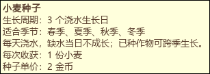

# 物品悬停介绍（2026-11-18）

基于 main `b57e075` 和本地尚未提交的商店样式调整，按用户要求增加类似星露谷的物品介绍。
修改 C/D 的 `farmicons.h`、`slotgrid.h`、`itembar.h/.cpp`、`farmpanel.h`、
`seedshopdialog.cpp`、`marketdialog.cpp`，主窗口仅登记提示框颜色，相关测试为
`panel_tests.cpp` / `farm_controls_tests.cpp`。无并行编辑者，团队消费者审查仍待完成。
未修改作物/经济/存档规则，本增量按用户要求交付到 `main`。

## 行为

鼠标在背包、箱子、物品栏格子停留后显示物品名称和用途；商店与收购的图标、物品名
显示同一份介绍。购买按钮仍显示价格提示。空格隐藏提示，背包拖动期间不显示介绍。
物品栏按照鼠标指向的格子显示，而非当前选中格；悬停不装备、不移动、不消费物品。
沿用 Qt 悬停延迟、离开格子隐藏和屏幕边界约束，提示采用木色背景与棕色边框。

种子从 CropCatalog 读取生长天数、适季、产量与种价，明确每天需浇水、缺水停滞，
已经种下的作物可跨季成长。天数表示基础浇水生长日；肥料仍可额外加速。
农产品显示出售单价和到站出售用途；锄头、水壶显示用途；肥料说明每株限一次和下次
浇水生长日额外成长一天，缺水保留效果。

截图来自面板测试，验证的是文本和排版；游戏主窗口另外设置木色工具提示主题。

## 原作参考

实际读取第三方反编译参考提交 `5225ef4`，
`Stardew Valley/StardewValley.Menus/InventoryMenu.cs` 的 `hover()`：
遍历命中格，只对非空物品取 DisplayName / getDescription / getHoverBoxText，
未命中时清空描述。采用命中物品、只读描述、名称与用途组合的逻辑；
以 Qt QHelpEvent/QToolTip 呈现，不复制原作代码、种子数值或资源。

## 验证

Qt 6.8.2 / MinGW 13.1 Release 应用构建成功。
面板套件10项、农具套件181项通过；新增实际 QHelpEvent 检查小麦周期/适季、
移到空格隐藏、商店土豆周期、工具和肥料用途，以及悬停第3格不改变第1格选中与库存。
真实提示控件截图已检查；原生桌面鼠标停留、不同显示器边缘体验尚未人工试玩。
整局交易套件另测30项通过、1项因设备条件跳过；本次相关三组共221项通过、0失败。
1.5倍DPI的悬停专项另测3项通过（含初始化/清理）。
