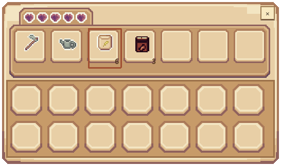

# lxk 本轮整合交付（2026-11-14）

本次按用户明确要求提交并推送到 GitHub 的 `lxk` 分支，保留 `main` 不变。本文件是本轮交付状态入口；其他阶段文档中“本地”“未提交推送”和八格旧界面的描述为历史记录，当前功能以本文和 README 为准。

## 基线与分支

- 当前结构基于 `main` 的 `09dfe88`，延续 `src/` 目录、qmake、Qt 6 Widgets / Multimedia 和 v4 存档。
- 原 `lxk` 为 `47eea51`，与主线分叉。本轮先提交整合源码，再保留旧 `lxk` 提交作为合并父历史，以移植后的新结构为最终代码树；不将旧根目录实现重复并入 `src/`，不强推、不删除旧提交。
- 旧地图 `lxk` 存档没有新增迁移承诺。主线原有有效 v2/v3 接续到 v4 的流程保留。
- 原 `Sprount` 工作目录的 `.pro.user`、Tiled 会话、个人素材包与未提交文件保持原样，不混入本轮提交。该目录不会自动切换成新版，使用新版应检出远端 `lxk` 到独立目录。

## 已交付行为

| 范围 | 当前行为 |
| --- | --- |
| 睡眠 | 床边按 F 打开确认，可白天休息；确认暂停时间，取消不推进日期。睡到下一次06:00，00:00—01:59到当天06:00 |
| 昏迷 | 02:00仍未睡自动关闭业务面板、安全回床并醒来；不扣钱、不丢物；无安全床位时暂停并允许修复后重试 |
| 结算/保存 | 午夜处理农田日结算；睡眠、昏迷、保存重试不会重复成长；保存失败保留已结算早晨并重试 |
| 背包入口 | E/Tab开包，E/Tab/Esc或右上角关闭符号关包；F处理床、商店、收购及储物 |
| 背包外观 | 仅保留七格首排、下方两排显示格和右上关闭按钮，无大段文字或背包空手入口；物品名通过悬停提示展示 |
| 物品栏联动 | 七项为锄头、水壶、四种种子、肥料；首排与真实 ItemBar/角色同序同选中，数量来自同一经济服务。库存为0显示空格，用尽后回空手；农场按0或再次点当前格可空手 |
| 地块距离 | 耕地、播种、浇水、施肥、收获仅脚下及相邻八格；远程点击先失败，不消耗资产、不改变作物，也不能绕过角色工具入口 |
| 主线玩法 | 保留四作物、适季播种、肥料、箱子、交易、四季调色和装饰、分季晨昏及睡醒保存提示音 |

本轮只接入用户指定 Premium UI 单张 `inventory_example_with_slots.png`，游戏路径 `resources/ui/inventory-hotbar.png`；原始完整包不提交，来源与署名见 [素材许可](ASSET_LICENSES.md)。爱心是素材自带装饰，没有引入生命值系统。

当前界面（真实控件截图，初始种子数量）：

## 未完成及保持的差异

- 拖拽、自由换位、拆堆仍未实现；下方两排是现有按品种汇总库存的展示，不是新增可自由分配的14格容量。
- 农产品容量仍是12份，种子和肥料另计；开包继续走时，02:00仍会昏迷。
- 没有整理、丢弃、装备、容量升级或新天气系统；没有用旧 lxk 的 HSV 季节换色覆盖主线精确配色。
- 本轮 Windows 通过 Qt Test 离屏键鼠验证，真实控件截图已目视检查；未把截图验收写成原生桌面人工试玩或实际扬声器听感验收。

## 验证与模块交接

应用 Release 由 Windows Qt 6.8.2 / MinGW 13.1 构建成功。提交前重建并直接运行九套 Qt Test，合计301项通过、0失败、1跳过（无默认音频设备用例，本机有默认音频设备）。Python Launcher 本机无可用 Python，使用 qmake / mingw32-make / exe 的 PowerShell 等价流程，没有安装依赖。

| 套件 | 通过 | 跳过 |
| --- | --- | --- |
| clock_ui | 37 | 0 |
| economy | 12 | 0 |
| farm_controls | 147 | 0 |
| gameplay_panel | 29 | 1 |
| panel | 8 | 0 |
| save | 24 | 0 |
| scenetransition | 17 | 0 |
| seasonappearance | 4 | 0 |
| core | 23 | 0 |

此前对同一精简界面另测1.5倍 DPI 面板8项通过；文档相对链接、代码围栏和 Git 空白检查通过。

跨域范围：C 的角色/地图输入、工具栏与稳定工具列表；D 的背包界面与显示快照；E 的时间、睡眠、HUD和主窗口顺序接入；A 的 QRC 追加一张指定素材。此次是用户授权的本地顺序整合，无并行文件编辑者，团队的消费者审查未由自动测试代替。

相关细节：[睡眠移植](LXK_SLEEP_INTEGRATION.md)、[背包迭代](INVENTORY_INTERACTION.md)、[操作距离](INTERACTION_REACH.md)、[接口约定](INTERFACE_CONTRACTS.md)。星露谷实际参考提交及方法位置分别记录在对应实现文档。
