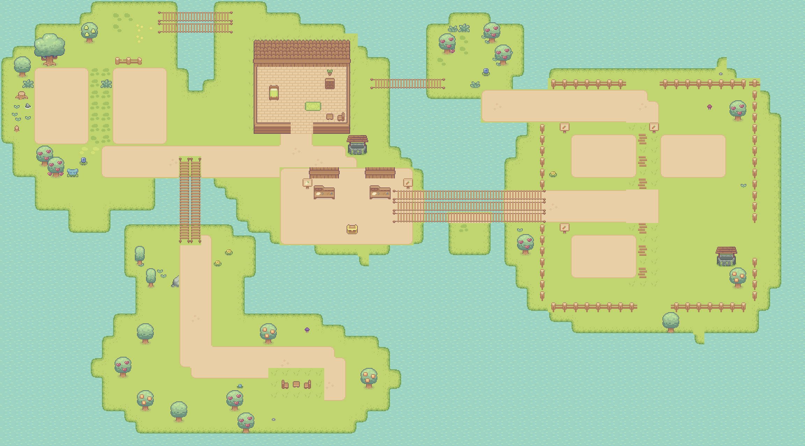
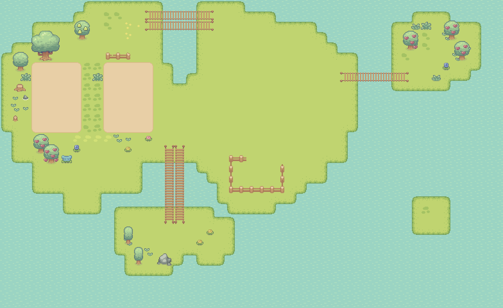
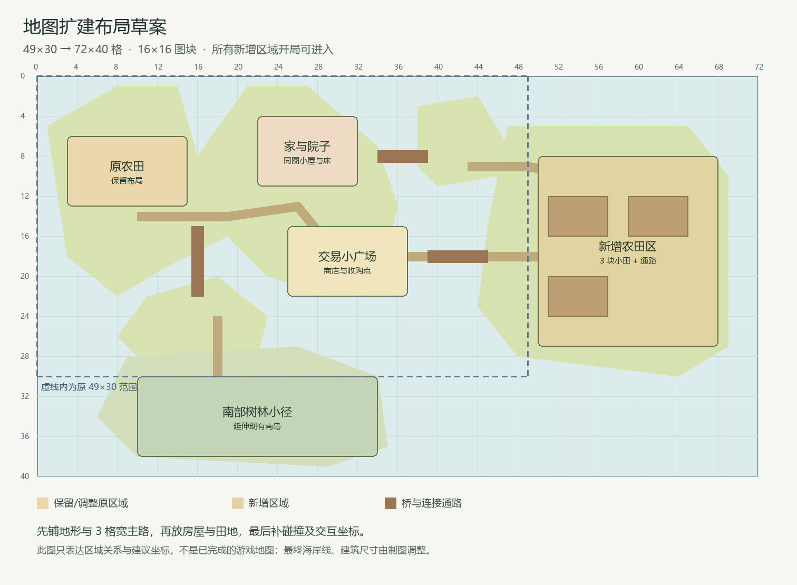

# A 角色地图扩建记录

已将正式运行地图 `map6.tmj` 从 49×30 扩为 72×40 格，保持 16×16 图块，面积约为原来的 1.96 倍。原农田和三处原桥保留，新增同图小屋、交易广场、东部三块农田、跨河桥及南部树林小径；新区域开局可进入。

A 地图初版提交为 ee0be11，已随 B 的 feature/b/crops-and-seasons 分支推送；B 作物/四季规则随后完成，C/D/E 新增玩法继续按分工接入。2026-11-11 用户授权继续支援 A，在 feature/a/season-assets 补齐季节资源，见 [SEASON_ASSETS](SEASON_ASSETS.md)。地图布局沿用本记录，尚未合入 main。

## 实际扩建地图

这张图由 Tiled 1.11.2 直接导出，正式地图仍可在 Tiled 中继续绘制。运行入口保持 `:/map/map6.tmj`，`map7.tmj` 和 `map8.tmj` 未变。

| 区域 | 最终范围或布局 | 交付情况 |
| --- | --- | --- |
| 原农田 | 两块约 x3–7、x10–14，y6–12 | 原有 70 个耕地图块完整保留 |
| 家与院子 | x22–31、y3–11，南向双格门 | 同图剖面小屋，已有床、家具、地毯和门外道路 |
| 交易广场 | x25–36、y15–21 | 两处柜台、招牌与收购箱，床/商店/收购范围已同步到代码 |
| 东部农田 | 栅栏约 x48–67、y7–27 | 三块 6×4 田，共 72 格；田间通路、水井和多个出入口 |
| 新主桥 | x35–48、y17–19 | 3 格宽，连接交易区与东部农田，保留原有桥梁 |
| 南部树林 | 约 x8–35、y26–38 | 由原南岛延伸，已有通路、树木、花石与休息空地 |

地图共 10 个图块层、1 个隐藏的编辑器标记层和 18 个外部图块集。原有 10 个图块集的 firstgid 未变，新增资源追加在末尾；总耕地为 142 格。水面、墙、家具、栅栏等使用地图碰撞层，全部 1477 个可行走格从出生点连通。

## 坐标与模块交接

坐标从 0 开始；区域写为 `(x, y, 宽, 高)`。以下值已接入当前分支，不再是待填建议。

| 项目 | 最终值 | 相关成员 |
| --- | --- | --- |
| 出生位置 | 角色左上角像素 `(400,192)`，角色中心约在图块 `(26,13)` | C/E；出生在家门外 |
| 家门 | 图块 `(26,11)` 到 `(27,11)` | C；双格入口，已实际进出 |
| 床边交互区 | `(25,8,2,2)`，位于真实床旁 | E；原睡眠规则保留，白天提示已验证 |
| 收购区 | `(28,18,2,2)` | D；已触发空包提示 |
| 商店区 | `(33,18,2,2)` | D；已实际打开种子商店 |
| 新田一 | x51–56，y12–15 | B/C；24 格现有规则可播种 |
| 新田二 | x59–64，y12–15 | B/C；24 格现有规则可播种 |
| 新田三 | x51–56，y21–24 | B/C；24 格现有规则可播种 |
| 地图范围 | 72×40 格，即 1152×640 原始像素 | C；镜头跟随与东西/南侧路线已试玩 |

`interaction_markers` 是隐藏的 Tiled 对象层，便于制图时查看上述地点。当前运行加载器不读取对象层的业务含义，实际触发值在 `mainwindow.h/.cpp`；改动地点时须同步两处并由对应成员复核。

### 本轮必要的跨模块接入

- `mainwindow.h` 只调整床、收购和商店三个矩形；`mainwindow.cpp` 只调整出生位置。
- `mapwidget.cpp/.h` 将旧的床/箱子占位图改成小型区域与文字标记，防止在真实家具上重复画床、遮住柜台。交互判定、交易、时间和成长规则未改。
- C 后续继续负责输入、碰撞及镜头打磨，D/E 在这些最终坐标上接入各自新功能；A 负责地图和资源维护。本次对共享文件的支援范围限定如上。
- 原有 HUD 在地图下边缘仍可能遮挡角色；窗口/HUD 的整体优化继续交 E/C，不将其计入已完成的界面打磨。

## 新资源与保存约定

原有图块编号保留，新增 TSX 均在 `tsx/`，图像在 `sprout/`，并登记到 `character.qrc`。房屋、柜台、招牌和水井选自已有 Sprout Lands 资源，不重新打包原始素材库。

| 新增图块集 | firstgid | 图片来源 |
| --- | ---: | --- |
| Wooden_House_Walls | 547 | 现有 Premium 地图包的房屋墙壁 |
| Wooden_House_Roof | 562 | 现有 Premium 地图包的房屋屋顶 |
| Basic_Furniture | 597 | 现有 `sprout/Basic_Furniture.png` |
| Paths | 651 | 现有 `sprout/Paths.png` |
| Workstation | 667 | 现有 Premium 地图包的 work station |
| Signs | 671 | 现有 Premium 地图包的 signs |
| Chest | 695 | 现有 `sprout/Chest.png` |
| Water_Well | 785 | 现有 Premium 地图包的 Water well |

保留素材原目录中的 Cup Nooble 署名和许可说明。已购 UI 包仍在仓库根目录 `Sprout Lands - UI Pack - Premium pack/`，200 个文件已完整解压；此次不把整个 UI 包加入 QRC，也未上传原始整包。D/C/E 可按 [素材盘点](ASSET_AUDIT.md) 继续选用。包内 5 个字体不含常用汉字区间，中文字体仍需另配。

继续使用 [Tiled 1.11.2](https://github.com/mapeditor/tiled/releases/tag/v1.11.2)，直接打开 `map6.tmj`，也可先开 `map7.tiled-project` 再选择该地图。原地图和本轮前已有文档改动已保存到本机备份目录；个人设置及构建缓存均在仓库外。

后续编辑时保持以下格式，避免出现 Tiled 能显示而游戏不能读取的内容：

- 有限、正交地图，16×16 图块，TMJ 使用 JSON 数字数组；不启用无限地图、Base64 或压缩数据。
- 保留现有逻辑层名 `collision`、`cultivatable`、`cultivated`、`crop`、`tree`；`paths` 和 `buildings` 是普通静态绘制层。
- `collision` 非零即阻挡，当前在编辑器中隐藏并锁定，需要修改时先解锁。新增岸线时同步水面碰撞，桥面留可行走空间。
- 游戏不读取嵌套组层、图层偏移或图块翻转/旋转标志；不要依赖这些效果。新增图块集追加，避免重排旧 GID。
- 普通可耕草地为 GID 13，耕地沿用现有土壤 GID；道路和建筑区域使用非可耕底图。不要把装饰草地误当成已接通的种植规则。
- 图片保持相对路径；游戏按 TSX 文件名推导同名 QRC 图片路径。资源清单、TSX 与 PNG 要一起同步，不提交 `.tiled-session` 或个人 IDE 设置。

## 实际验证记录

2026-11-08，Apple 芯片 Mac，Qt 6.10.3 / Clang Release：

| 检查 | 结果 |
| --- | --- |
| 地图结构、资源路径、图块编号 | 73 项 QRC 资源均存在，各图层 72×40，引用图块均在图集中 |
| 原内容保留 | 原有 70 格农田逐格一致，原桥保留；旧地图编号未重排 |
| 通路连通 | 1477 个可行走格全部连通；出生点、门、床、商店、收购及南部空地可达 |
| Tiled | 1.11.2 原生导出并回读，完整地图显示正常，界面 0 错误 / 0 警告 |
| 实际 Qt 加载与种植 | 使用生产构建的 QRC、MapLoader、WorldState 和 CollisionDetector 检查，18 个图块集加载，新增 72 格均成功播种；6 个关键站位无碰撞 |
| 应用与核心测试 | Mac Release 构建成功；现有核心测试 14 通过、0 失败 |
| 游戏实际操作 | 家门进出、白天床边提示、收购点空包提示、商店弹窗、东西跨桥往返、南桥/树林通行与镜头跟随已验证 |
| 存档保护 | GUI 使用独立应用名和 Qt 测试数据目录；默认存档及其备份保留 |

Windows 尚未实机验证。此次未新增平台专用业务代码，仍为原 qmake/C++17/Qt 工程，资源路径均为相对路径；这些是兼容依据，不能替代 Windows 测试。

Windows 队友使用原 Qt Kit，在独立构建目录重新 qmake、Release 编译并运行核心测试，再从新局核对：家门可进出、床边 E、商店/收购点 E、东部三块田可播种、桥可走而水面不能走、南部树林可达、镜头边界及保存重开。旧 49×30 存档不要求迁移，切勿覆盖需要保留的个人旧档。

本轮没有验证完整新增玩法（四季、背包、连续昼夜等仍由其他成员开发）、跨季种植、Windows 声音或发布部署，不登记为已完成。

## 原布局参考

## B 后续资源追加（2026-11-08）

B 在 A 已验收的地图上仅追加 firstgid 789 的 Spring_Crops 图集，没有改变地图图层与交互坐标；资源总数现为 19 套图集、76 项 QRC。此前 A 的 18/73 为当时提交记录。四品种阶段、图标与验证见 [B 接入清单](CROP_CATALOG.md)。

## A 季节资源交付（2026-11-11）

已完成四季配色与草木/积雪装饰、QRC 登记、真实地图对照图和独立资源验证工具，地图/GID/碰撞未变。资源总数现为 79，图集仍 19 套。运行时外观由 C/E 接入，Windows 尚未实测；按用户最新要求暂缓后续发布整理。资源细节见 [SEASON_ASSETS](SEASON_ASSETS.md)。
