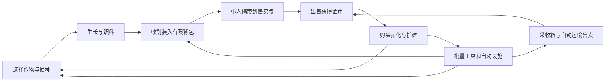

# Clover-Cog 种菜增量游戏项目规划

状态：讨论草案 v0.4（仅更新工程事实与协作组织），2026-10-22。本文描述计划功能，不代表当前版本已实现。

玩法细则见 [玩法设计草案](GAMEPLAY_DESIGN.md)：补充第一轮体验、作物收益与操作取舍、设施覆盖和吞吐、自动化后的订单目标。数值均为待验证提案。

素材核对见 [UI 与玩法素材盘点](ASSET_AUDIT.md)：记录可复用图集、资源清单接入状态、中文字体覆盖及需补绘的自动化设施。

实现顺序与验收见 [开发文档](DEVELOPMENT.md)：整理模块职责、数据与命令接口、存档和物流约束，以及 DEV-001–016 的任务依赖。

已确认方向：基于现有 Qt 模板开发，沿用当前像素 UI 风格，加入出售和可购买强化；体验由前期亲手种菜逐步过渡到后期自动化。前期玩家必须操控小人到售卖点出售，随身作物容量有限，可升级背包，后期解锁自动化售卖。具体数值、作物名单及内容规模为建议，需试玩调整。

## 1. 产品定位与核心循环

玩家从一小片菜地起步，通过出售收成获得金币，逐步改善作物、工具、土地和生产设施，最终经营一座会自行播种、收割和出售的农场。成长既体现在收入，也体现在一次能处理多少地、哪些重复工作已经交给设施完成。



设计原则：

- 每个阶段至少提供一次能感知到的操作变化，例如单格变整排、收割后自动补种、局部自动收割。
- 同一时刻保留 2–3 个值得攒钱的目标，让玩家选择先扩大规模还是改善效率。
- 主动操作在后期仍可用于订单、快速换种和调整设施，不要求始终高频点击。
- 首版用金币作为唯一通用货币。新货币、加工链和周目继承在核心循环成立后再评估。
- 以轻松经营为基调：成熟作物不枯萎，缺水不死亡，暂不加入体力耗尽、害虫损失和交易税。

## 2. 模板现状与复用边界

早期素材与构建盘点保留；2026-10-22 工程规划按 8ddf705 重新核对源码。具体实现事实与旧文档差异见 [工程架构](ARCHITECTURE.md)，本轮未执行构建或运行。

| 模块 | 当前实际情况 | 规划处理 |
| --- | --- | --- |
| 地图、角色与镜头 | Tiled 地图、WASD 移动、碰撞、方向动画 | 保留并修正坐标和边界问题 |
| 像素 UI | 木色面板、米色按钮、猫爪光标、底部六槽栏 | 继续使用现有配色、边框和图标语言 |
| 播种与生长 | WorldState 记录两种 CropType；共用参数，生长/成熟仍依赖 GID 240–243 | 建立独立作物配置和地块状态 |
| 收获 | 收获信号已带 CropType，MainWindow 内仍仅有小麦计数 | 改为按作物和数量写入统一库存 |
| 物品栏 | 六张完整图片对应六种选择 | 改为背景、槽位、图标和选中状态组合绘制 |
| 工具 | 锄地可用，水壶有动画，树木清除会同步图块和碰撞 | 给工具加入作用范围和统一执行入口；保留已有树木行为 |
| 时间 | 已共用 GameClock，尚无生产暂停/恢复和离线能力 | 统一生产时间来源；日历作为展示派生值 |
| 经济和存档 | 未见金币、出售、强化、存档系统 | 作为首版基础系统新增 |

重点源码入口：

- [mainwindow.cpp](../mainwindow.cpp)：窗口组装、mapClicked 信号连接、收获计数。
- [mapwidget.cpp](../mapwidget.cpp)：视口、点击收获、WorldState 调用与生长定时器。
- [rpg.cpp](../rpg.cpp)：角色移动和动画；工具分派已在 playercontroller.cpp。
- [itembar.cpp](../itembar.cpp)：滚轮选择和整张物品栏图片切换。

## 3. 强化体系：九条路线

各路线针对不同问题。数字提升可做成少量等级，改变操作规则的能力做成单次解锁，避免大量重复购买同一种百分比。

| 路线 | 示例升级顺序 | 玩家得到的新能力或选择 | 阶段 |
| --- | --- | --- | --- |
| 种子育种 | 高产种 → 优质种 → 单作物专精 | 更多产量、优质品；选择重点培育哪种作物 | 首版高产，后续品质与专精 |
| 收割工具 | 单格 → 三格一排 → 3×3 范围 | 一次处理更多成熟地块 | 首版 |
| 播种工具 | 单格 → 一排播种 → 收割后补种 | 降低重新播种负担，补种沿用该地块作物 | 首版 |
| 土壤与灌溉 | 改良土壤 → 范围水壶 → 喷灌设施 | 加快生长；选择覆盖位置和服务哪些作物 | 首版 |
| 土地扩建 | 初始菜圃 → 相邻地块 → 新区域 | 更多种植位置，但也带来操作与设施覆盖需求 | 首版 |
| 背包与运输 | 背包扩容 → 田边卸货 → 自动运送 | 一趟携带更多作物，逐步减少出售往返 | 首版 |
| 生产自动化 | 自动收割设施 → 提升吞吐 → 多片农田 | 从亲自收割转向分配作物和设施 | 首版基础，后续扩展 |
| 销售与订单 | 到站出售 → 代售服务 → 订单保留 | 从亲自卖菜到委托出售，决定存货用途 | 首版销售，后续订单 |
| 加工与组合 | 腌菜缸 → 配方 → 多作物组合 | 选择直接卖还是等待加工，形成生产配比 | 后续 |

### 3.1 首版建议的 14 个强化条目

“条目”可以有少量等级，不代表 14 个完全独立的大系统。背包和运输是本轮新增方向。

| 条目 | 效果建议 | 解锁条件建议 |
| --- | --- | --- |
| 高产种子 | 对选定作物增加收获产量，最多 3 级 | 首次出售 |
| 背包扩容 | 提高随身作物容量，暂试 12 → 24 → 48 → 96 单位 | 首次亲自出售 |
| 土壤改良 | 缩短生长时间，最多 3 级 | 首次出售 |
| 长柄镰刀 | 从单格收割变为面向方向的一排三格 | 完成基础种收引导 |
| 宽幅镰刀 | 解锁 3×3 范围收割，显示范围预览 | 已购长柄镰刀并扩地一次 |
| 排播工具 | 在一排空闲耕地上播种 | 解锁第二种作物 |
| 自动补种 | 手动或设施收获后按原作物立即补种，可关闭 | 已购排播工具 |
| 范围水壶 | 一次照料 3×3 区域 | 开放灌溉教学 |
| 小型喷灌器 | 持续给覆盖地块提供生长速度加成 | 已购范围水壶 |
| 土地扩建 | 按地块包购买，有 2 次扩建里程碑 | 累计出售达标 |
| 收购价提升 | 提高基础售价，最多 3 级 | 累计出售达标 |
| 自动收割设施 | 周期性处理覆盖区内的成熟作物，有吞吐上限 | 首次扩地及累计收获达标；补种独立购买 |
| 田边代售箱 | 玩家就近卸货，购买的代售服务分批收购，可暂停 | 完成若干次亲自出售；具体门槛待调 |
| 自动运输 | 将采收箱内允许售卖的作物运至收购站，抵达后结算 | 具备代售服务和采收箱 |

解锁条件使用游戏进度而非现实等待。购买前可看到前置要求、价格和当前/升级后效果。

### 3.2 避免所有强化都变成同一种收益加成

- 增产提升每次收获的价值；收割范围降低操作次数；扩地增加规模；自动设施改变玩家要做的事。
- 土地扩建提高理论产能，但自动收割吞吐不足时不会全部变成实际收益，形成下一步优化目标。
- 喷灌器和自动设施占用可种植位置，首轮采用小范围覆盖，让位置选择有代价。
- 自动设施只处理自己的覆盖区，玩家仍可在其他区域主动种收；后续购买扩大覆盖或吞吐。
- 品质概率后置，首版以确定性增产为主，便于玩家理解和调参。
- 主动玩家可频繁种短周期作物；稍后回来的玩家可选择长周期高单次收益作物。高阶作物不应完全取代早期作物。

## 4. 出售与经济规则

### 4.1 首版交易流程

前期收获进入有限容量的随身背包，玩家操控小人走到地图内的固定收购站，靠近后按交互键打开出售面板。选择出售 1 个、出售该类全部或出售全部；展示数量、单价和总价，成功后扣除背包作物并增加金币。

- “出售全部”只出售农产品，不出售工具、设施或永久解锁。
- 农产品按类型堆叠显示，但总数量受背包容量限制；首轮暂定每个农产品占 1 单位，容量为 12，可逐级扩容。工具和永久解锁的种子不占农产品容量。
- 暂不让已解锁作物每次播种都消耗金币；新作物通过购买永久解锁。金币归零后仍能继续种菜恢复收入。
- 背包可随时查看；手动出售仅在收购站交互范围内可执行，执行交易时再次检查距离。远处入口只能指引售卖点位置。
- 背包放不下某格完整收获时，该格作物留在田里；范围收割逐格检查容量。检查成功后才写入物品并结束该轮生长，不掉落、不丢失。
- 中期代售箱允许玩家在田边卸货，由已购买的服务分批收购；它有独立容量。后期自动运输连接采收箱与收购站，玩家不再需要搬运自动区产物。
- 背包、采收箱、代售箱和运输货物是独立库存；自动出售只处理授权的代售/运输货物，不远程扣除玩家背包。转移和出售均原子结算。
- 后续订单加入后，为每种作物提供“保留数量”，出售全部和自动出售均遵守保留设置。

### 4.2 作物差异

首个可玩版本实现 2 种行为不同的作物；首版完整目标扩至 4 种。萝卜、土豆、南瓜、番茄为暂定名称，需确认图集阶段映射。开发期可先保留小麦占位，但模型不能固定为小麦。

| 作物定位 | 体验目的 | 规则建议 |
| --- | --- | --- |
| 快熟型：萝卜 | 第一笔收入、主动操作 | 生长短，单次价值低 |
| 多产型：土豆 | 单次收获更有反馈 | 生长稍长，一次产出多个 |
| 大额型：南瓜 | 适合暂时离开和补充大额目标 | 生长长，单次价值高 |
| 再生型：番茄 | 改变重复种植流程 | 成熟后可再收获有限次数，再重新播种 |

短周期、长周期作物同时比较“每地块每分钟收入”和“每次玩家操作收入”。再生型作物与自动补种分别定义：未耗尽收获次数时进入下一生长周期，耗尽后才重新播种。

### 4.3 数值起点与验证方法

以下仅作为第一轮试验输入，不是最终平衡：初始 6 块地；快熟作物每 30 秒产 1 个，单价 4 金币；第一项强化价格可从 36–48 金币试起。全部种下后，一轮理论收入为 24 金币，首购约需 2 轮，实际还要计入播种和收割时间。

```text
理论每分钟收入 = 地块数 × 每次产量 × 单价 × 60 / 生长秒数
升级回本时间 = 升级价格 / 升级后每分钟收入增量
重复等级价格 = 向上取整(基础价格 × 增长系数^已购等级)
```

实际收入还要计入背包容量、往返售卖时间，以及自动收割、运输和出售的吞吐；上面的理论公式只是农田产值上限。首轮重复等级增长系数可试 1.5–1.8；范围收割和自动化使用独立价格，不强行套同一公式。

每轮试玩记录：第一次收获、第一次亲自出售、第一次强化、第一次范围操作和第一次自动循环的时间；记录每趟装载量、出售往返耗时、满包阻塞次数、每分钟点击次数、闲置成熟地块数与实际金币入账。根据结果调整。

## 5. 体验阶段与长期目标

这些时间是待验证的体验目标，不是开发工期或强制解锁时间。

| 阶段 | 首次游玩的目标区间 | 主要目标与变化 |
| --- | --- | --- |
| 学会循环 | 0–5 分钟 | 种下首批作物、携带至收购站出售、买到第一个可感知强化 |
| 扩大手动效率 | 5–15 分钟 | 背包升级、第二种作物、批量工具、第一次扩地 |
| 局部自动化 | 15–30 分钟 | 自动补种、喷灌、覆盖局部菜地的自动收割 |
| 经营整片农场 | 30–60 分钟 | 自动运输与出售，与采收、存储和运输能力匹配的布局 |

首版演示目标是约 30–45 分钟内让玩家体验一次完整的自动种收售循环，不承诺长期留存。延长内容应优先加入订单、加工和布局，而不是单纯把下一次升级的价格提高。自动化路线可跳过最高级手动工具，保留主动效率与省心经营两种投资方式。

第二阶段内容：图鉴里程碑、混合作物订单、加工配方、作物专精。完成订单可解锁配方或区域，初期仍使用金币结算。

第三阶段候选：新农场、温室、可选的“育种传承”周目系统。重置前必须明确展示保留与重置内容；是否加入重置玩法待首版验证后决定。

## 6. UI 与交互规划

素材查看结果：当前图集已有米色/棕色按钮、木质边框、金币/购物车等图标，可用于扩展商店。继续保留猫爪光标、像素作物和地图视觉。

- 顶部显示金币、背包已用/总容量、当前阶段目标；接近满包时提示，时间移为次要信息。
- 底部保留工具栏，用可组合槽位呈现工具，种子通过一个入口切换作物。
- 右侧设置强化商店、背包和售卖点指引；靠近收购站时出现交互提示，后期代售箱也需就近交互卸货。
- 商店首版按“作物、工具、农场”分页，升级卡展示图标、效果、价格、等级和前置条件。
- 鼠标悬停地图时预览工具范围、设施覆盖及无效地块；成熟作物用轻微高亮或提示标识。
- 面板打开时屏蔽对地图的点击和角色移动；生产继续。真正暂停时生产与动画一起停止。
- 关闭面板后恢复角色焦点；增加明确的选中态和金币不足提示。
- 以现有 520×320 为逻辑布局起点，优先验证 2 倍整数缩放和窗口适配；像素素材使用最近邻缩放，点击坐标按同一比例转换。
- 已核对现有像素字体，基础汉字区没有字形；中文正文需配套支持中文的字体，数字与图标仍保持像素风。

## 7. 技术实现路线

### 7.1 从现有代码逐步拆分

继续使用 C++17、Qt Widgets、qmake、Tiled 和 QRC。先提取游戏状态，保留已有渲染和角色，再接经济与强化，不要求整体重写。

| 数据/组件 | 职责 | 现有代码改动 |
| --- | --- | --- |
| GameState | 金币、背包及容量、各箱体库存、运输货物、地块、强化、设施和解锁状态 | 替代 MainWindow 中单独的小麦计数 |
| CropDefinition / CropState | 作物基础配置、地块实际种类、生长进度、剩余收获次数 | 替代由 GID 判断作物身份和成熟状态 |
| FarmSimulation | 推进生长，处理播种、收获、范围操作，供设施调用 | 从 WorldState 及 MapWidget 调用链继续提取；补种调度归 E |
| EconomyService / InventoryService | D 的经济服务负责出售购买；库存服务负责转移容量；统一校验权限 | 新增；UI 只请求交易并展示结果 |
| TransportSystem | 代售批次、运货路线、装载量、到达与结算状态 | 自动化阶段新增，在线和离线共用规则 |
| UpgradeDefinition | 价格、前置、最大等级、效果类型和参数 | 用配置驱动首批升级，避免逐项写进按钮回调 |
| SaveManager | 版本化存档、加载、备份及离线结算 | 新增；通过应用数据目录存储 |
| Shop/Inventory 面板 | 展示状态并发出用户操作 | 使用现有素材组装，不持有独立经济数据 |

建议用 JSON 存作物、升级及设施配置；游戏状态先使用普通 C++ 结构和 Qt 容器，必要的状态变化通过信号通知 UI。

地块以作物 ID 和生长进度作为真实状态，GID 只负责渲染映射。土壤、灌溉和强化共同计算有效生长速度，升级时保留已完成进度，不重置播种时间。

### 7.2 先处理的模板问题

1. 明确屏幕坐标、地图像素坐标和图块坐标的转换，集中处理，范围工具共用。
2. 地图加载失败、缺图层、负坐标和越界点击应安全退出；角色活动也限制在地图有效范围。
3. 合并重复的地图点击业务入口：一次点击按当前工具执行一个命令，避免收获后无意再次触发播种。
4. 将作物类型、成熟判定和收获数量从固定小麦 GID 中拆出。
5. 物品栏从完整图片切换改为动态组成，为更多作物和强化状态留位置。
6. 统一生产计时与暂停规则；在线使用单调经过时间，日历由同一累计时间推导。

砍树不作为首个经济循环的前置。早期扩地可解锁土地包；8ddf705 已支持树木属性和图块/碰撞同步，保留现有行为，边界与实际输入另行验证。

### 7.3 存档与自动化

- 首个可玩闭环就做存档，保存金币、背包容量与内容、角色位置、作物进度、强化等级、区域、设施以及状态版本；自动化阶段补充箱体容量、货物归属和运输进度。
- 交易成功后和固定间隔保存，使用原子写入和一份有效备份；读取失败应给出提示。
- 自动收获、补种和售货复用手动命令，采用稳定执行顺序并确保同一作物不会被收获两次。
- 离线收益放在自动化之后：未购买自动设施时，离线最多让田里的作物成熟；只有解锁对应自动化的区域才继续循环。箱体满则暂停采收；已购代售/运输可以继续，个人背包不会离线自行出售。
- 离线阶段可暂设 2 小时计算上限，回归显示实际结算；时钟回拨按零离线时长处理。此上限为待调参数。
- 批量推算离线状态，不能逐帧跑数小时；需与同等时长在线模拟对照，覆盖成熟、补种、收割吞吐和库存保留规则。

## 8. 迭代顺序与验收

团队已明确为五人，具体成员、工时和交付日期待定；按可演示成果拆里程碑，不预设日历工期。分工见 [执行计划](IMPLEMENTATION_PLAN.md)。

| 里程碑 | 交付内容 | 完成条件 |
| --- | --- | --- |
| M0 模板整理 | 基础运行体验、输入与边界、游戏状态和作物配置 | 两种作物独立状态和原型收获反馈；边缘操作不崩溃；有限入库在 M1 DEV-004 验收 |
| M1 第一个可玩闭环 | 金币、有限背包、到站出售、商店、首批 5 项升级、存档 | 能完成种→收→携带→卖→买；背包扩容减少往返，重启后进度一致 |
| M2 主动成长 | 排播、范围收割、扩地、灌溉、四种作物与 UI 反馈 | 批量操作明显减少点击；至少两条合理的购买路线 |
| M3 自动化 | 自动补种、喷灌、收割设施、箱体、运输、自动出售和离线结算 | 局部农田可连续自动种收运售；满箱正常停工、腾空后恢复 |
| M4 首版打磨 | 经济调参、引导、音效、存档恢复、发行包 | 新玩家可独立理解升级；目标时长内到达自动循环 |
| 后续 | 订单、加工、专精、新区域 | 在首版试玩反馈基础上选择投入 |

M1 首批五项升级建议为：高产种子、土壤改良、三格收割、背包扩容、第一次扩地。先验证产量、操作和运输之间的选择，再展开其他路线。

关键验证场景：远离收购站不能出售；满包/满箱不损失作物；重复交易不重复结算；库存转移前后数量守恒；范围工具不越界；手动与自动收获同一格只结算一次；存档恢复在途货物不重复到账；离线结算符合已解锁能力。

## 9. 待后续细化的决定

方向已确定为先手动后自动；本轮新增的详细规则记录在 [玩法设计草案](GAMEPLAY_DESIGN.md)。后续优先细化：

1. 首版选哪些作物，以及现有图集的可用阶段和图标映射。
2. 自动收割外观建议采用稻草人助手，行为采用定点覆盖；制作前确认素材或补绘需求。
3. 首轮升级价格和解锁顺序，重点验证手动阶段是否有趣、自动化是否来得过早。
4. 五名成员的姓名/账号、可用工时和交付时间；五模块任务方案见 [团队职责](TEAM_MODULES.md)。

M0–M1 的实现任务已整理到 [开发文档](DEVELOPMENT.md)。下一步按任务依赖完成可玩的种收运售与强化循环，再扩展全部内容。
