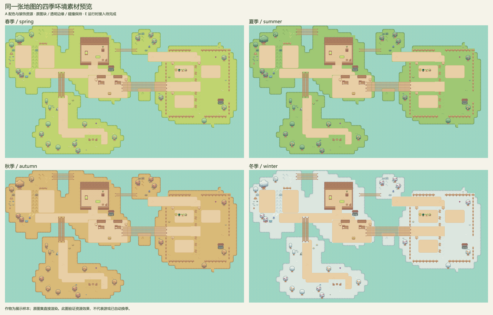

# A 四季环境资源交接

2026-11-11，MAP-001 季节素材阶段，本地分支 `feature/a/season-assets`，基于已推送的 B 提交 `7d60b6b`。用户授权由 semiconductor007 继续支援 A；B 的成员认领不变。用户已明确暂缓后续发布整理，本次只交付地图/季节资源及接入说明。A 地图初版见 [MAP_EXPANSION_PLAN](MAP_EXPANSION_PLAN.md)。本次交付数据驱动的配色与像素装饰资源，E 的自动换季/昼夜功能仍待接入。

## 实际预览

预览使用正式 map6.tmj、QRC、MapLoader、WorldState 和 MapRenderer，图中的四种成熟作物是临时展示样本，不读写个人存档。它验证资源效果，不代表主游戏已经按日期自动切换季节。

原始双倍像素图：[春](images/seasons/spring-map.png)、[夏](images/seasons/summer-map.png)、[秋](images/seasons/autumn-map.png)、[冬](images/seasons/winter-map.png)。

## 交付形式与风格

沿用当前 Sprout Lands 原图，新增四套精确 RGB 对应表和四种 16×16 像素装饰图案，以 JSON 描述。E 根据配置一次性生成并缓存纹理；无需新增图集编号或复制四张地图。未新增经过生成式图像工具处理的位图，不将任何概念图作为运行素材。

| 季节 ID | 外观 | 小型装饰 |
| --- | --- | --- |
| spring | 原有嫩黄绿色，作为默认外观 | 粉白小花 |
| summer | 草地和树冠更浓绿 | 细草簇 |
| autumn | 草地金黄、树冠黄褐 | 少量橙褐落叶 |
| winter | 地表浅雪色、树冠覆雪色 | 零散积雪小块 |

草木原有的明暗结构、透明边缘、16×16 切图位置全部保持。农田土壤与道路保留暖色，可与雪地分辨；作物、家具、建筑、工具、招牌图标、角色、水面不应用季节调色。冬季不新增河面结冰通行，也不改变作物规则。首版不含裸树重绘、动态飘雪、天气和屋顶专用积雪图。

## 文件与 QRC 契约 v1

| 文件 | QRC 地址 | 用途 |
| --- | --- | --- |
| resources/seasons/manifest.json | `:/seasons/manifest.json` | 四季 ID、颜色表、7 个原图绑定、尺寸和 SHA-256、绘制策略 |
| resources/seasons/decorations.json | `:/seasons/decorations.json` | 四种矩形像素图案、12 个地图装饰点 |
| resources/seasons/NOTICE.txt | `:/seasons/NOTICE.txt` | 原作者署名与许可来源说明 |
| tools/season_preview/ | 独立 qmake 工具 | 验证资源并使用真实地图渲染预览，非游戏入口 |

资源只增加上述 3 项 QRC，现为 79 项；地图仍为 19 个图集，地图数据和 GID 未变。配置使用 UTF-8，相对文件路径和 QRC 路径，无个人绝对路径。

`schemaVersion=1`，`assetVersion=2026-11-11`。季节 ID 与 B 的 `SeasonCalendar::seasonId()` 一致，先春、夏、秋、冬。manifest 中 palette 的键为原图 `#rrggbb`，值为当前季节颜色；未列颜色原样保留，alpha 始终不变。每次从原始纹理生成，不在已调色结果上再次映射。

### 7 个纹理绑定

| tilesetSource | 原图 QRC 文件名 | 尺寸 |
| --- | --- | --- |
| tsx/Grass.tsx | Grass.png | 176×112 |
| tsx/Basic_Grass_Biom_things.tsx | Basic_Grass_Biom_things.png | 144×80 |
| tsx/Tilled_Dirt_Wide_v2.tsx | Tilled_Dirt_Wide_v2.png | 176×112 |
| tsx/Mushrooms, Flowers, Stones.tsx | Mushrooms, Flowers, Stones.png | 192×80 |
| tsx/Trees, stumps and bushes.tsx | Trees, stumps and bushes.png | 192×112 |
| tsx/Grass_tiles_v2.tsx | Grass_tiles_v2.png | 176×112 |
| tsx/Water_Well.tsx | Water_Well.png | 32×32 |

图片均位于 `:/tilesets/sprout/`。按 `Tileset::sourcePath` 匹配绑定；不要用数组位置猜测，也不要全屏统一改色。原图 SHA-256 用于检测资源变动：替换原图后由 A 重新核对色表、图块尺寸和预览，再更新记录。

### 12 个装饰点

以图块坐标计，位置来自 decorations.json，均为可达空草地，避开现有建筑、道路、农田和交互点。它们不写进 collision、crop 或 cultivated 层；无物品掉落、成长或交易含义。

运行绘制时选取当前季节的 decoration 图案，将其 rects 中的小矩形平移到 tile×16 位置，最近邻/整数像素绘制。放在地图之后、角色和 HUD 之前。玩家锄地或种植后跳过该点；不增加碰撞、不阻碍种植、不写存档。

## C / E 接入顺序

1. C 提供一个只替换显示纹理及绘制装饰的入口，保留 WorldState 和原始图集缓存；E 拥有当前季节的选择与环境显示调度。
2. E 从唯一 GameClock 取得累计日期，经 B 的 SeasonCalendar 得到 ID，读取 manifest 中同名项；不维护第二套季节计数。
3. 按 assetVersion + seasonId + tilesetSource 缓存调色纹理，只在首次使用/季节变化时生成。参考工具中的 previewTexture，逐像素仅替换指定 RGB，alpha 不变。
4. 原始 firstGid、tileWidth/tileHeight、tilesPerRow 和地图各层保持；更换显示纹理时不重新 initialize 世界、不重载个人存档，不丢失作物和浇水状态。
5. 按上述装饰规则绘制。E 的昼夜层随后处理场景亮度，HUD 单独显示；日期切换、睡眠和读档都从同一份时间推导外观。
6. 联调覆盖四季、冬末跨年、换季时田里有作物、已有施肥、睡眠与读档，确认业务状态无额外变化；同一日期不重复日结算。

本次没有修改 C/E 负责的地图显示或时钟业务源码，也未声明消费者已确认契约。C/E 可先运行独立预览工具核对资源效果，再按各自分支接入。

## 验证记录

2026-11-11，Apple 芯片 Mac / Qt 6.10.3 / Apple Clang 21：

- 主应用 Release 构建成功；原有核心测试 21 项通过、0 失败。
- 独立预览工具从真实 QRC 读取配置并验证 7 个原图 SHA-256、尺寸及地图绑定；四季共 28 份预览纹理逐像素校验 alpha、颜色映射与图块位置。
- 四种像素装饰矩形均在 16×16 范围内；12 个位置无碰撞且不覆盖原有前景图块；保留原地图的水面底层。
- 已导出四张双倍地图和对照图，目视核对草地/树木、冬季边缘、道路农田对比及四种作物保持原色。
- 主游戏的自动季节切换与昼夜未接入，未将离线预览当作游戏交互验证；本次未听测音效。
- Windows 尚未实测。新增运行资源为 JSON/QRC；预览工具为 Qt Core/Gui+C++17，保留原 qmake/Qt 版本。Windows 队友按工具 README 构建并运行，核对四张图与 21 项核心测试，再执行 C/E 联调。

## 当前交付范围

按用户最新要求，后续发布整理、部署及公开发布暂缓，本轮不纳入任务完成条件。已生成的本地打包试验和新增脚本/发布说明保留在仓库外备份，不纳入本次代码变更，也不继续推进。四季资源、预览工具和 C/E 接入说明保留。

素材来源核对见 [ASSET_LICENSES](ASSET_LICENSES.md)。Windows 的实际构建/运行与 C/E 自动换季仍待团队联调；本轮没有下载或安装新的 Qt、图像编辑器或素材包。
