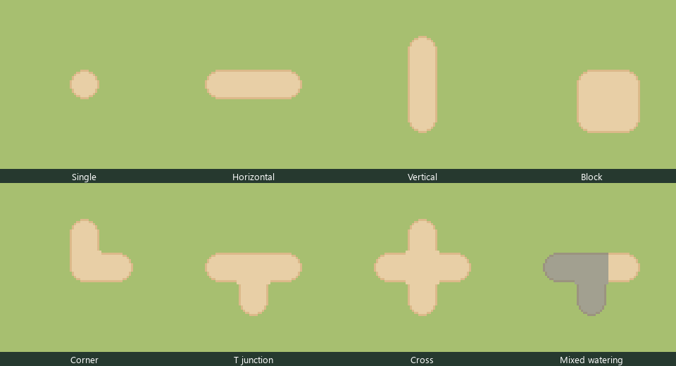

# 耕地四向自动拼接（2026-11-14）

用户要求按星露谷逻辑完善耕地边角。本轮在 `lxk-sleep-integration` 的 `c9c6d44` 上支援 C 的地图绘制，只修改 `maprenderer.h/.cpp`、既有角色/绘制测试和说明，不改 B 的 WorldState、地图、图集、经济或存档。无并行编辑者；用户随后明确授权本轮提交并推送到 `lxk`，不修改 `main`。

## 参考与适配

实际查阅本机第三方反编译仓库提交 `5225ef409e42a6159a82cf81200bf6eb315c9961` 的 `StardewValley.TerrainFeatures/HoeDirt.cs`：

- `gatherNeighbors()` / `updateNeighbors()` 收集相邻耕地，维护邻接掩码并通知邻格。
- `UpdateDrawSums()` 用 `neighborMask & 0xF` 查 `drawGuide` 得到干土源图位置，水状态另用 `wateredNeighborMask`。
- `OnAdded()` / `OnRemoved()` 在耕地增减后更新邻接；`DrawOptimized()` 先画土壤，再画湿土、肥料、作物。

本项目采用四向邻接决定边角的同类算法，以渲染时只读查询上下左右替代邻接缓存/通知，避免增加可漂移的存档字段。邻格在可见区域外也参与判断；地图外视作不连接，斜角单独相接不合并。

当前 Sprout 图集 `Tilled_Dirt_Wide_v2.png` 并非原作16形状图集：使用其左上3×3边角区域，将每格拆成四个8×8小块，按各自横纵方向是否连接选取角、边或中心。这样能覆盖16种连接形态，包括独立格、单格宽横/竖条、块状、L、T和十字，不需要重新绘制素材。

项目差异：没有引入原作的专用湿土图集、稻田判断或额外湿土邻接边界。湿土保留现有蓝灰着色，用 SourceAtop 在图集缓存上着色以保留源图透明度，再绘制同一邻接轮廓，避免透明角被整格色块填满。原始纹理不变；缓存按源纹理 cacheKey 更新，不累计着色。

## 状态与兼容

- 新耕地逻辑 GID 仍为135，既有九种耕地 GID 都只作为耕地状态读取。不会将显示边角写回 cultivatedLayer。
- 耕地增减、每日空地恢复、读档后的下一次绘制直接使用最新邻接；作物和浇水状态不被渲染修改。
- 不重载地图，不改 GID、QRC、季节资源、产量或交易，不新增存档字段；既有农田规则继续识别原来的编号。
- 若没有匹配的16×16、11列原图集，保留旧图块与旧湿土叠色回退，不凭空猜测另一套素材布局。

## 验证

Windows Qt 6.8.2 / MinGW 13.1 Release 主程序构建成功。相关消费者重新构建：farm_controls 180项、gameplay_panel 29项、clock_ui 37项通过，合计246通过、0失败、1项因音频设备条件跳过。其余不使用 MapRenderer 的测试本轮未重跑。

新增32个干/湿组合测试枚举全部16种四向连接，用独立列举的预期图集格号核对四个象限，验证绘制不修改耕地、浇水和结算日期。另测移除邻格后恢复原轮廓、干湿透明度一致，并使用真实图集导出下图目视检查。测试只加载本机字体以便离屏预览标签可读，没有打包字体，也没有使用生成图片代替运行结果。本轮未执行原生桌面人工试玩。

