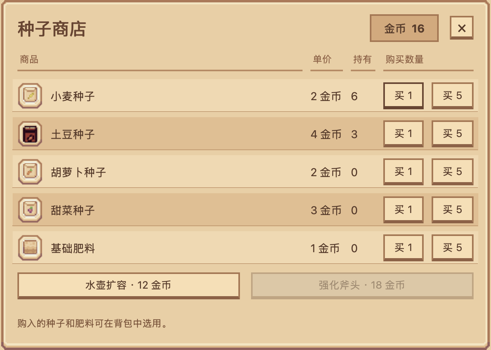
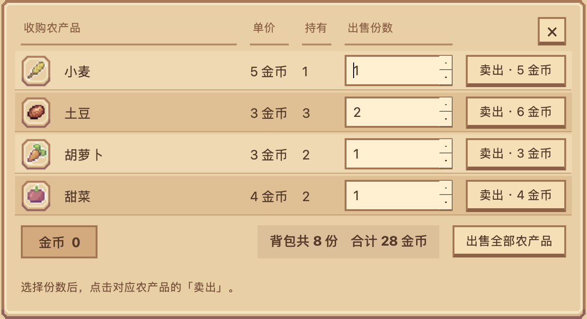

# 商店与收购面板像素风调整（2026-11-18）

按用户要求基于当前 main `b57e075` 优化商店、收购 UI，并去掉主窗口系统标题栏。
本次不合入 lxk 的 HUD、睡眠或耕地规则，保留 main 的自由熬夜、夜间睡眠与交易规则。
本增量按用户要求交付到 `main`。

## 布局

两个交易面板使用现有 `:/farm-ui/slots.png` 的浅色物品框 `(2,98,44,44)` 作九宫格边框，
边角按像素绘制；标题、金币、商品行、按钮、数量输入统一为木色、米色和棕色。
商品行交替底色，保留物品图标、价格、持有数和必要操作。
收购窗口从商品表开始，右上角的 `×` 和 Esc 均可关闭。选定份数后，行内按钮显示本笔收入，底部另列整包总价与全部出售按钮。商店可以买 1 份或 5 份种子及肥料，底部另有一次性的水壶和斧头升级。
键盘 Tab 导航、Enter 激活、禁止长按重复交易的逻辑保留。

截图由临时测试库存生成，不是初始库存/金币。

主窗口使用 `Qt::FramelessWindowHint` 移除系统标题栏；商店和收购也移除各自系统标题栏。
后续按用户要求默认启动全屏，视区扩展规则和验证见[全屏模式](FULLSCREEN.md)。
主窗口 F11 切换全屏/窗口，Esc 沿用主线暂停菜单，Alt+F4 沿用保存退出流程。
没有新增自定义标题栏；移除系统栏后原生标题栏拖动、最大化按钮不再提供。
游戏内顶部绿色状态栏保持当前 main 的布局，未在本次替换为 lxk 的右上 HUD。

## 实现边界和参考

顺序支援 D 的 `src/ui/farmpanel.h`、`seedshopdialog.cpp`、`marketdialog.cpp`；
主窗口编辑窗口为 C/E 的 `src/app/mainwindow.cpp`；共享测试为
`tests/panel_tests.cpp` 和 `tests/clock_ui/clock_ui_tests.cpp`，另更新本文、开发入口与截图。
无并行编辑者，不改经济服务、价格、背包、交易提交或存档。团队消费者审查仍待完成。

实际查阅第三方反编译参考提交 `5225ef4` 的 `StardewValley.Menus/ShopMenu.cs`，
其 `draw()` 用纹理框绘制商品区域、逐行展示 forSale 与价格，并复用库存显示。
本次采用纹理面板、分行商品信息及独立关闭入口的展示方式，保留项目现有按钮交易模型；
不引入原作货币、商人系统或完整商店背包交互，也不使用原作素材。

## 验证

Qt 6.8.2 / MinGW 13.1 Release 主程序构建成功；面板套件9项通过，包括购买、出售、
键盘导航与重复操作防护。增加交易窗口无系统标题栏、关闭入口位置和真实控件截图检查。
截图已目视核对行布局、边框、文字和按钮；桌面人工试玩未执行。
主窗口/时钟套件50项、整局面板套件30项通过；合计89项通过、0失败、1项条件跳过。
跳过为无默认音频输出测试，本进程有默认设备。1.5倍DPI下面板套件另测9项通过。
F11快捷键已接入；原生窗口全屏/恢复、系统任务栏和Alt+F4的桌面操作尚待人工试玩。
