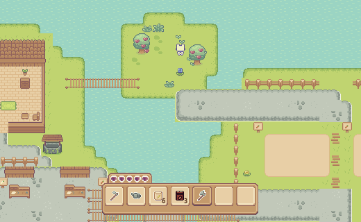

# 砍树与木材（2026-11-18）

用户授权基于main实现砍树、利用已有素材并参考星露谷；后续明确授权完成后自动推送。
基线85c77db，在codex/tree-chopping独立开发，验证后交付main。任务TREE-001。

## 操作与规则

- 进入农场时补发一把斧头。已有斧头（包括箱内）不重复发放；背包满时放入箱子。
  若斧头在背包下两排或箱内，先拖到首排七格物品栏，再点击选用。
- 走近树干底部，选斧头左键点击，范围仍为角色周围一格（含斜角）。树冠不是攻击目标。
- 当前首版试玩参数：树木100生命，每击25，四击倒下留下50生命树桩，再两击移除。
  倒树获得5木材，树桩获得2木材；这些是本项目参数，不是声称照搬原作数值。
- 木材沿用现有真实背包格位，支持拖动、拆分、合并和箱子存取，不占农产品12份容量。
  新种类仍需空格；最后一击先检查木材能否入包，失败不扣树木生命、不掉资源。
- 木材暂为材料，不加入商店、收购、合成；没有树木种植、再生、技能、体力或工具升级。
- 保存树木生命、树桩和清除状态，以及随身/箱内木材。重进不会刷新已砍树。

## 原作参考和适配

实际查阅第三方反编译仓库提交5225ef4：
`Stardew Valley/StardewValley.Tools/Axe.cs`的DoFunction将命中传给地形工具动作；
`StardewValley.TerrainFeatures/Tree.cs`的performToolAction扣除伤害，performTreeFall
分别处理树冠倒下、树桩生命和倒向，资源通过物品路径发放。
采用命中树干→一次伤害→树冠倒下/树桩分阶段→资源提交的处理顺序。
倒向按玩家左右位置决定，倒下期间阻止再次砍该树；一个挥砍动作内不能重复伤害。
本项目木材直接经EconomyService原子入包，不模拟地面拾取；动画回调不发物品。

## 素材与整树映射

现有Premium Charakter Spritesheet的15/16/18行用于斧头下/上/右动作，左向镜像。
斧头图标为已引用Basic_tools_and_meterials的(16,0,16,16)，木材从Premium的
tools-n-meterial-items图集(0,32,16,16)取样，原图登记resources/trees/materials.png。
tree_fall_animation_sprite_sheet原样登记resources/trees/fall.png，13帧，每帧64×48。
对应普通绿树春季使用倒树序列；其他树型/季节以当前树图旋转淡出，避免果树变成普通绿树。
树桩使用现有树图集local74；木屑为纯展示。图像均来自Cup Nooble Sprout Lands Premium，
未新增外部素材包，沿用既有许可与署名。

按Trees, stumps and bushes图集识别1×2、2×2和3×3整树，校验完整格位模式，
不是按连通域盲合并，故相邻树也独立。只识别tree图层的既有完整树型，不把灌木、
石块或静态背景装饰当作可砍树。树冠移除后释放原树范围碰撞，树桩保留锚点碰撞。

axe_hit.wav与tree_fall.wav由tools/generate_tree_sounds.py确定性合成，无原作采样。
单声道PCM16/22050Hz，分别0.18秒/0.65秒；静音或音频不可用不影响砍伐。
本机尚未进行扬声器主观听测。

## 接口与文件窗口

B：worldstate.h/.cpp整树目录、预览/提交和保存快照。
C：playercontroller.h/.cpp、rpg.cpp、mapwidget.h/.cpp、itembar.cpp，负责输入、动作、显示。
D：economyservice.h/.cpp、savemanager.cpp、farmicons.h、storagedialog.cpp，负责木材/斧头和格位守恒。
A/E：character.qrc、farm-sounds.qrc、小图/音频、mainwindow.cpp接入和一次性发放。
共享测试：core_tests.cpp、farm_controls_tests.cpp；文档和截图一并更新。
无并行编辑者；团队消费者审查仍待完成，自测不代替成员审查。

TreeChopResult携带预览生命/阶段，提交复核，过期或重复命令失败。
EconomyService::collectWoodWithAction先验证候选格位再同步提交树木变化，拒绝重入。
木材稳定ID4002，斧头1003；旧工具与作物ID、七列UI保持不变。
v4存档增加可选world.trees、economy.woodCount/woodInChest，格位一致性一起校验。
老档缺字段默认完整树与零木材。文件层校验树字段结构和范围，运行层再按真实地图锚点校验，
不兼容主档仍走现有备份恢复。不要用旧程序覆盖本轮新档，旧程序不认识新物品ID和树木字段。

## 验证记录

Windows Qt6.8.2 / MinGW13.1 Release：九组Qt Test合计359项通过、0失败、1项跳过，
包含初始化/清理；分组为时钟51、经济15、农具182、整局30、面板10、存档25、过渡17、
季节4、核心25。跳过项是原有无默认音频输出专项，本进程有输出设备。
1.5倍DPI砍树专项另测4项通过。旧“斧头退役/树木仅装饰”的测试已更新为树冠保护测试，
新斧头工具不再按旧阶段的禁用规则验收。

Release应用构建成功；核心专项覆盖整树/树桩/清除、存档往返、木材存取、
非法树状态失败不变、背包满不调用世界修改、重入和重复提交保护。
真实地图交互检查斧头选用、距离、树冠保护、动作期间重复点击与邻树不被误伤。
真实控件截图已目视检查，桌面人工操作和扬声器听感未验收。

